# 01 · Fractals: escape-time & IFS

**What's in here:** Mandelbrot, Julia, Burning Ship, Newton, Sierpinski, Menger, Apollonian/Kleinian gaskets.

**The idea in one breath:** Zoom forever, find the same shape. Iterate z → z² + c and color by how fast it runs away (escape-time), or recursively copy-shrink a shape (IFS).

32 designs. Each is a pair: open the `.html` in any browser (self-contained, no server); the `.js` is the raw sketch source.

| | Design | Renderer | Notes | From |
|---|---|---|---|---|
| 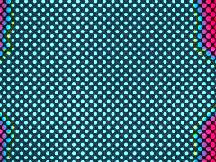 | [**acid-fractal**](acid-fractal.html) · [js](acid-fractal.js) Kaleidoscope (Psychedelic Collage) · Neon Acid Palette (Color Fields) · Acid Vibration Palette | WebGL2 / three.js |  | repo_script_js5_code |
| 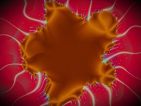 | [**acid-fractals**](acid-fractals.html) · [js](acid-fractals.js) Simplex Noise (from noise_fields) · Complex Math for Multibrot · Palettes (from color_fields) | WebGL2 / three.js |  | repo_script_js5_code |
| 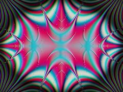 | [**acidic-fractal**](acidic-fractal.html) · [js](acidic-fractal.js) [THE-LISTS] Domain 8: Digital Folklore &amp; Glitch Methodologies · [color_fields] Neon Acid Cosine Palette · [structural_color] Thin-Film Interference (Chitin / Mycelial Wall) | WebGL2 / three.js |  | repo_script_js5_code |
| 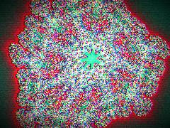 | [**acidic-neon-fractal**](acidic-neon-fractal.html) · [js](acidic-neon-fractal.js) [COLOR FIELDS] - Acid Neon Palette · [STRUCTURAL COLOR] - Thin Film Interference · [FRACTALS] - Celtic / Burning Ship Hybrid | WebGL2 / three.js |  | repo_script_js5_code |
| 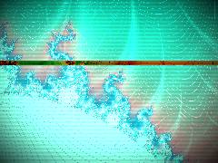 | [**candy-glitch-mandelbrot**](candy-glitch-mandelbrot.html) · [js](candy-glitch-mandelbrot.js) 1. Defend and Initialize State · Time management for pause functionality · Neon Acid / Y2K Gloss Palette (Autophagic Memory Splicing) | WebGL2 / three.js |  | repo_script_js5_code |
| 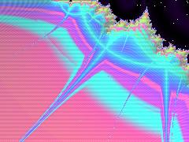 | [**CandyMandelbrot**](CandyMandelbrot.html) · [js](CandyMandelbrot.js) THE ALCHEMICAL MANDELBROT · Mechanism: Autophagic Memory Splicing + Moiré Repository Protocols · A maximalist candy-prism fractal engine using RGB phase-shifted distance estimators. | WebGL2 / three.js |  | repo_script_js5_code |
| 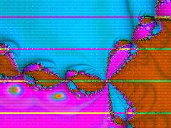 | [**colorful-fractal**](colorful-fractal.html) · [js](colorful-fractal.js) COLOR SYSTEMS: OKLab to sRGB · ALCHEMICAL MATH: Complex Operations · WET ENGINE: Fungal Noise / FBM | WebGL2 / three.js |  | repo_script_js5_code |
| 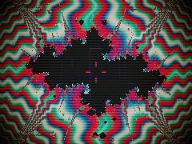 | [**colorful-fractals**](colorful-fractals.html) · [js](colorful-fractals.js) Hash function for procedural noise · Manhattan distance Worley noise (Circuit Board / Sector Faults) · Jitter the cells over time to simulate unstable memory | WebGL2 / three.js |  | repo_script_js5_code |
| 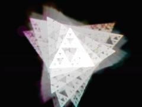 | [**colorful-sierpinski**](colorful-sierpinski.html) · [js](colorful-sierpinski.js) [THE VOID RULE] - Initialize the feral substrate · 1. ENVIRONMENTAL DECAY &amp; OUTWARD GROWTH PRESSURE · (Repo: Damage Aesthetics - Copy of Copy Decay + Repo: Mycelial Networks - Expansion) | Canvas 2D |  | repo_script_js5_code |
| 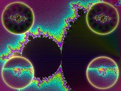 | [**fractal-friday-mandelbrot_20260626_155624**](fractal-friday-mandelbrot_20260626_155624.html) · [js](fractal-friday-mandelbrot_20260626_155624.js) Simple hash and noise for low-power glitch effects · Candy Neon Spectral Palette · Subordinate mesh gradient background | WebGL2 / three.js |  | shader_files_2 |
| 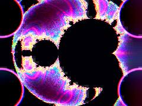 | [**fractal-friday_20260626_154045**](fractal-friday_20260626_154045.html) · [js](fractal-friday_20260626_154045.js) Render targets for ping-pong feedback (Afterimage &amp; Datamosh) · Prevents banding in afterimage trails · Complex math helpers | WebGL2 / three.js |  | shader_files_2 shader_files_2 |
| 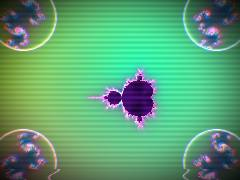 | [**fractal-friday_20260626_154345**](fractal-friday_20260626_154345.html) · [js](fractal-friday_20260626_154345.js) Acid Candy Palette · Hot pink, cyan, electric blue · Structural Color / Thin Film Iridescence | WebGL2 / three.js |  | shader_files_2 shader_files_2 |
| 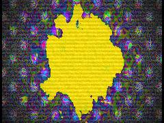 | [**fractaldance**](fractaldance.html) · [js](fractaldance.js) Simplex noise implementation · Fractal Brownian Motion · Lisa Frank x Cyberdelic Neon Palette | WebGL2 / three.js |  | repo_script_js5_code |
| 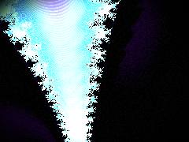 | [**mandelbrot-candy-glitch**](mandelbrot-candy-glitch.html) · [js](mandelbrot-candy-glitch.js) FERAL DESIGN-BRAIN: ENGAGED · PROTOCOL: HOLOGRAPHIC CANDY-PRISM MANDELBROT · REPO GENOMES: fractals (escape-time, DE, orbit traps), color_systems (Oklab/cosine), THE-LISTS (glitchwave_dichrome) | WebGL2 / three.js |  | repo_script_js5_code |
| 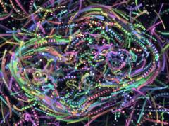 | [**math-choreography**](math-choreography.html) · [js](math-choreography.js) UTILS &amp; MATH (From &#x27;shiny&#x27; and &#x27;fractals&#x27; repos) · Julia Set smooth escape time · SHINY DOCTRINE HELPERS | Canvas 2D |  | repo_script_js5_code |
| 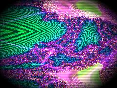 | [**menger-burn**](menger-burn.html) · [js](menger-burn.js) The Feral Burning Ship: A Psychedelic Recursive Disaster Monument · Calculate delta time for pause functionality · Saturated, feral palette function | WebGL2 / three.js |  | repo_script_js5_code |
| 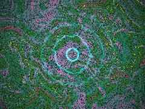 | [**mondayafternoon_20260615_135022**](mondayafternoon_20260615_135022.html) · [js](mondayafternoon_20260615_135022.js) MATH &amp; COMPLEX ALGEBRA (Kleinian Groups) · OKLAB PERCEPTUAL COLOR (Color Systems) · NOISE &amp; ADVECTION (Continuous CA / Wet Engine) | WebGL2 / three.js |  | shader_files_2 |
| 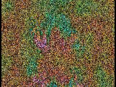 | [**mondayafternoon_20260615_135818**](mondayafternoon_20260615_135818.html) · [js](mondayafternoon_20260615_135818.js) FERAL MECHANISM: Topological Hemorrhage + Chrono-Stratigraphic Fluid · The math wants to be a perfect Apollonian gasket. The environment wants it to melt. · OKLab Perceptual Color Math (Repo 7) | WebGL2 / three.js |  | shader_files_2 |
| 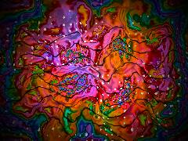 | [**mondayafternoon_20260615_140917**](mondayafternoon_20260615_140917.html) · [js](mondayafternoon_20260615_140917.js) PERCEPTUAL COLOR MATH (OKLCh to sRGB) · From color_systems repo: Perceptually uniform color spaces · WEIRD MATH UTILS | WebGL2 / three.js |  | shader_files_2 shader_files_2 shader_files_2 |
| 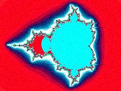 | [**neon-acid-fractal**](neon-acid-fractal.html) · [js](neon-acid-fractal.js) [THE-LISTS / Domain 8: Digital Folklore] - Glitch &amp; Data Rot · [color_fields / neon_acid] - Psychedelic Pop Candy Groovy Palette · Overclock the saturation for acidic burn | WebGL2 / three.js |  | repo_script_js5_code |
| 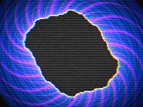 | [**neon-julia-bloom**](neon-julia-bloom.html) · [js](neon-julia-bloom.js) Complex multiplication · Acid / Cyberdelic Neon Palette Generator · Boost saturation for that &quot;candy-acid&quot; look | WebGL2 / three.js |  | repo_script_js5_code repo_script_js5_code repo_script_js5_code |
| 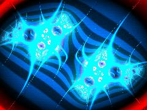 | [**neon-julia-morph**](neon-julia-morph.html) · [js](neon-julia-morph.js) Perceptually uniform OKLab to sRGB conversion (from color_systems) · Maximalist Candy-Acid Palette · Fluid distortion on base UVs (psychedelic_collage / moire) | WebGL2 / three.js |  | repo_script_js5_code |
| 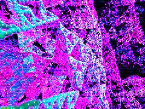 | [**neon-sierpinski**](neon-sierpinski.html) · [js](neon-sierpinski.js) 2D Rotation Matrix · High-tension Cyberdelic Palette (OKLab inspired) · Inject neon bursts | WebGL2 / three.js |  | repo_script_js5_code |
| 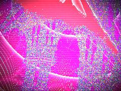 | [**neon_menger_ship**](neon_menger_ship.html) · [js](neon_menger_ship.js) Helper for random noise · Palette: Acid Vibration + Cyberdelic Neon · Mouse interaction | WebGL2 / three.js |  | repo_script_js5_code |
| 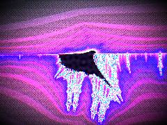 | [**NeonBurningShip**](NeonBurningShip.html) · [js](NeonBurningShip.js) Hashing for noise and glitch · Quasicrystal geometry for the interior &quot;abyss&quot; · Core Burning Ship Engine with Orbit Traps and Distance Estimation | WebGL2 / three.js |  | repo_script_js5_code |
| 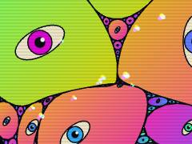 | [**rainbow-gasket**](rainbow-gasket.html) · [js](rainbow-gasket.js) Incorporating: · Apollonian Gasket fractal generation (Descartes&#x27; Circle Theorem) · Fluid &quot;rainblown&quot; domain warping via 3D value noise | Canvas 2D |  | repo_script_js5_code |
| 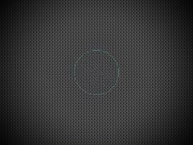 | [**rainbow-kleinian**](rainbow-kleinian.html) · [js](rainbow-kleinian.js) 4x4 Bayer Matrix for structural dither · IQ Cosine Palette - Neon Acid (color_fields) · Möbius Circle Inversion | WebGL2 / three.js |  | repo_script_js5_code |
| 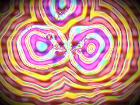 | [**rainbow-math**](rainbow-math.html) · [js](rainbow-math.js) Feral Noise Generator · OKLCh to Linear sRGB (Color Systems Principle) · Circle Inversion (Apollonian Gasket / Kleinian Limit) | WebGL2 / three.js |  | repo_script_js5_code |
| 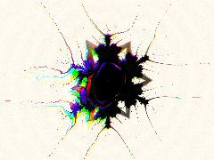 | [**rainbow-math_20260614_184305**](rainbow-math_20260614_184305.html) · [js](rainbow-math_20260614_184305.js) Noise &amp; Entropy (THE-LISTS: Archive Rot, Fluid Dynamics) · Cymatics: Bessel Standing Wave Approx · Structural Color: Thin Film Interference | WebGL2 / three.js |  | shader_files_2 |
| 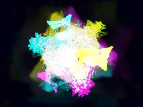 | [**sierpinski-gasket**](sierpinski-gasket.html) · [js](sierpinski-gasket.js) x, y, colorIndex, size · The Void Rule: Dark background with Copy-of-Copy Decay (Feedback Loop) · Void Black from cyberdelic_neon | Canvas 2D |  | repo_script_js5_code |
| 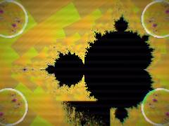 | [**spectral-mandelbrot-portal_20260626_155150**](spectral-mandelbrot-portal_20260626_155150.html) · [js](spectral-mandelbrot-portal_20260626_155150.js) Fractal Friday: Candy-Acid Mandelbrot with Julia Portals &amp; Datamosh · Optimized for Low-Power Hardware: Capped iterations, single fractal pass, simple ping-pong FBO. · Disabled for performance | WebGL2 / three.js |  | shader_files_2 |
| 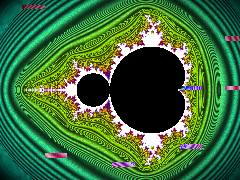 | [**spectral_mandelbrot**](spectral_mandelbrot.html) · [js](spectral_mandelbrot.js) State management for smooth panning and zooming · Complex multiplication · Acid Neon Palette (Psychedelic Collage / Resist Dye) | WebGL2 / three.js |  | repo_script_js5_code |
