# 02 · Reaction-diffusion & Turing patterns

**What's in here:** Gray-Scott, Turing morphogenesis, Belousov-Zhabotinsky: spots, worms, labyrinths, coral.

**The idea in one breath:** Two chemicals: one makes more of itself, one eats it, and they spread at different speeds. That imbalance self-organizes into leopard spots and fingerprints.

31 designs. Each is a pair: open the `.html` in any browser (self-contained, no server); the `.js` is the raw sketch source.

| | Design | Renderer | Notes | From |
|---|---|---|---|---|
| 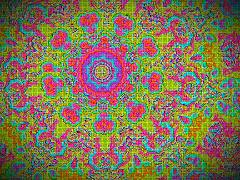 | [**acidic-palette**](acidic-palette.html) · [js](acidic-palette.js) FERAL SHADER: Multi-scale Turing Morphogenesis + Acid Vibration Palette + CMYK Misregistration + Kaleidoscope · 2D Rotation Matrix · Gyroid function for organic structural noise | WebGL2 / three.js |  | repo_script_js5_code |
| 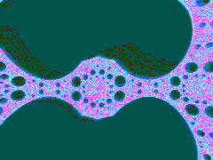 | [**amazing_20260618_111501**](amazing_20260618_111501.html) · [js](amazing_20260618_111501.js) INITIALIZATION &amp; PERSISTENCE GUARD · PING-PONG FRAMEBUFFERS FOR WET ENGINE · High precision for reaction-diffusion | WebGL2 / three.js |  | shader_files_2 shader_files_2 |
| 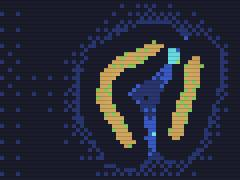 | [**bright-automata**](bright-automata.html) · [js](bright-automata.js) THE GREEDY MESHING AUTOMATON: A Quantized Reaction-Diffusion System · A continuous, organic Gray-Scott Reaction-Diffusion system is forcibly · &quot;pixel-locked&quot; and passed through a retro-shader pipeline every frame. | Canvas 2D |  | repo_script_js5_code |
| 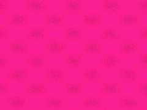 | [**chroma-diffusion**](chroma-diffusion.html) · [js](chroma-diffusion.js)  | WebGL2 / three.js |  | repo_script_js5_code |
| 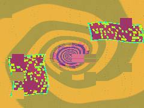 | [**chroma_codec_shrine_20260618_191140**](chroma_codec_shrine_20260618_191140.html) · [js](chroma_codec_shrine_20260618_191140.js) Ping-Pong FBOs for Morphogenesis and Datamosh History · R: U (Activator), G: V (Inhibitor), B: Datamosh History, A: Unused · WET ENGINE: PING-PONG SHADER (Reaction-Diffusion + Datamosh Advection) | WebGL2 / three.js |  | shader_files_2 shader_files_2 |
| 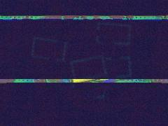 | [**chroma_codec_shrine_20260618_192031**](chroma_codec_shrine_20260618_192031.html) · [js](chroma_codec_shrine_20260618_192031.js) &quot;CHROMATOPHORE CODEC SHRINE&quot; · Blends Turing morphogenesis, cuttlefish chromatophores, op-art, · early internet UI debris, datamoshing, and cross-processed damage. | WebGL2 / three.js |  | shader_files_2 shader_files_2 shader_files_2 |
| 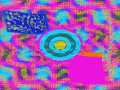 | [**chromacodec_shrine_20260618_184444**](chromacodec_shrine_20260618_184444.html) · [js](chromacodec_shrine_20260618_184444.js) FBO Setup for Ping-Pong (Reaction-Diffusion &amp; Datamosh History) · Required for Reaction-Diffusion precision · SIMULATION SHADER (Morphogenesis + Datamosh Advection) | WebGL2 / three.js |  | shader_files_2 shader_files_2 |
| 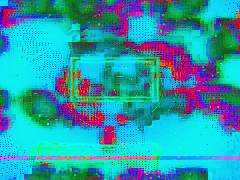 | [**chromatophore_codec_shrine_20260618_185338**](chromatophore_codec_shrine_20260618_185338.html) · [js](chromatophore_codec_shrine_20260618_185338.js) PASS 1: Morphogenesis (Reaction-Diffusion) · Anisotropic diffusion (Op-Art zebra waves) · Spatially varying Feed and Kill (Central Portal) | WebGL2 / three.js |  | shader_files_2 |
| 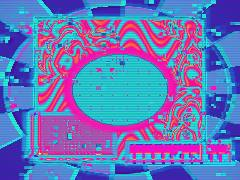 | [**chromatophore_codec_shrine_20260618_190133**](chromatophore_codec_shrine_20260618_190133.html) · [js](chromatophore_codec_shrine_20260618_190133.js)  | WebGL2 / three.js |  | shader_files_2 shader_files_2 |
| 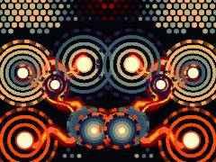 | [**dreamtime-repo_20260615_222908**](dreamtime-repo_20260615_222908.html) · [js](dreamtime-repo_20260615_222908.js) ASTRAL-DREAMTIME WET ENGINE · A feral fusion of Australian Aboriginal Dreaming track grammar, · Belousov-Zhabotinsky chemical oscillation, and Astral-OS Anu hardware. | Canvas 2D |  | shader_files_2 shader_files_2 |
| 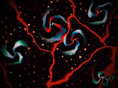 | [**dreamtime-repo_20260615_224341**](dreamtime-repo_20260615_224341.html) · [js](dreamtime-repo_20260615_224341.js) ALCHEMICAL NOISE ENGINE · COLOR PROTOCOLS · Neon Cyberpunk Acid (Parasite/BZ Spirals) | WebGL2 / three.js |  | shader_files_2 shader_files_2 shader_files_2 |
| 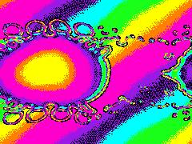 | [**dynamic-interactive-design**](dynamic-interactive-design.html) · [js](dynamic-interactive-design.js) PASS 1: Gray-Scott Reaction-Diffusion (cellular_automata) · 3x3 Laplacian kernel · Spatially varying parameters for diverse animal prints (spots, stripes, mazes) | WebGL2 / three.js |  | repo_script_js5_code |
| 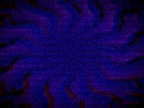 | [**dynamic-rd**](dynamic-rd.html) · [js](dynamic-rd.js) Feral Mechanism: Acid-Warped Cyclic Symmetry Turing Morphogenesis · We reject standard Gray-Scott spots. Instead, we build a wet engine where · the feed (F) and kill (k) rates are warped by a rotating cyclic domain (kaleidoscope), | WebGL2 / three.js |  | repo_script_js5_code |
| 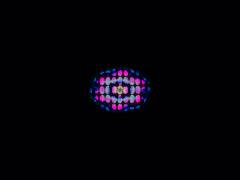 | [**github-interactive**](github-interactive.html) · [js](github-interactive.js) We use FloatType for the Gray-Scott simulation to prevent precision collapse · SIMULATION SHADER · Marries Repo 1 (Tessellations) and Repo 2 (Reaction-Diffusion). | WebGL2 / three.js |  | repo_script_js5_code |
| 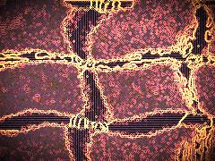 | [**interactive-design**](interactive-design.html) · [js](interactive-design.js) SIMULATION SHADER: Advected Reaction-Diffusion (G2 Phi Field + CA) · G2 Latent Phi Field (Repo 3) · Advection via Phi Field | WebGL2 / three.js |  | repo_script_js5_code |
|  | [**lorenz_gray_scott**](lorenz_gray_scott.html) · [js](lorenz_gray_scott.js) Gray-Scott &amp; Decay resolution · 64x64 = 4096 particles for thick Lorenz brush · RENDER TARGETS | WebGL2 / three.js |  | repo_script_js5_code |
|  | [**morphogenetic_attractor_20260809_090159**](morphogenetic_attractor_20260809_090159.html) · [js](morphogenetic_attractor_20260809_090159.js) Ping-pong buffers for simulation state · R: Pathogen (U) · G: Structure/Anatomy (V) | WebGL2 / three.js |  | shaderfiles3 |
| 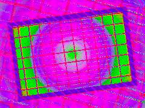 | [**radshit_20260619_112936**](radshit_20260619_112936.html) · [js](radshit_20260619_112936.js) FBO Setup - HalfFloat for precision in CA and datamosh without breaking mobile · CA PASS (Reaction Diffusion / Hidden Machine Mind) · Gray-Scott Reaction Diffusion with spatially varying feed/kill | WebGL2 / three.js |  | shader_files_2 shader_files_2 |
| 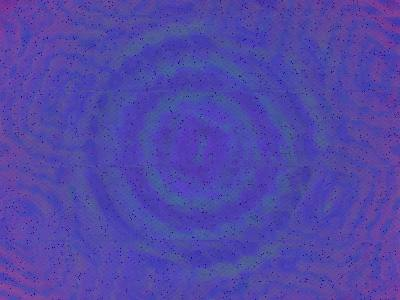 | [**radshit_20260619_114812**](radshit_20260619_114812.html) · [js](radshit_20260619_114812.js) HASH &amp; NOISE (The Glitchcore / Dream Physics Entropy) · OKLAB COLOR SCIENCE (Absolute Color Rules) · CROSS-PROCESSING CHEMISTRY &amp; STRUCTURAL COLOR | WebGL2 / three.js |  | shader_files_2 shader_files_2 shader_files_2 |
| 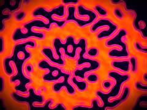 | [**rd-lace-sampler**](rd-lace-sampler.html) · [js](rd-lace-sampler.js) Clean up previous instances if resizing · INIT SHADER: Seeds the initial RD state · Radial seeds for lace medallions | WebGL2 / three.js |  | repo_script_js5_code |
| 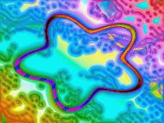 | [**retro-diffusion_20260618_094401**](retro-diffusion_20260618_094401.html) · [js](retro-diffusion_20260618_094401.js) Crystalline Morphology Overlay via Voronoi distance field · Spatially varying Feed and Kill based on crystalline structure · Atompunk Starburst Injection (Parasite-Host Logic) | WebGL2 / three.js |  | shader_files_2 shader_files_2 |
| 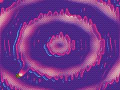 | [**retro-diffusion_20260618_095345**](retro-diffusion_20260618_095345.html) · [js](retro-diffusion_20260618_095345.js) Isotropic Laplacian for Inhibitor (V) · Anisotropic Laplacian for Activator (U) - Retrofuturistic Racing Stripes · Morphogenesis Beyond Gray-Scott: Cyclic Symmetry Fold Parameter Map | WebGL2 / three.js |  | shader_files_2 |
| 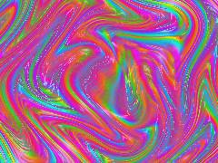 | [**retromorph_20260618_092028**](retromorph_20260618_092028.html) · [js](retromorph_20260618_092028.js) VIBRANT PALETTE - STRICTLY NO BLACK, NO WHITE · MORPHOGENESIS ENGINE (Multi-Scale Cellular Turing Fake) · Cyclic symmetry fold (Radiolarian / Diatom biology) | WebGL2 / three.js |  | shader_files_2 |
| 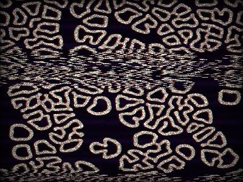 | [**vhs-coral**](vhs-coral.html) · [js](vhs-coral.js) Base Gray-Scott parameters (Coral Growth / Fingerprint hybrid) · Heat Damage Simulation: the tape is melting in a hot car, · mutating the reaction-diffusion parameters geographically over time | WebGL2 / three.js |  | repo_script_js5_code |
| 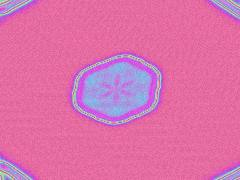 | [**vibrant-diffusion**](vibrant-diffusion.html) · [js](vibrant-diffusion.js) Initial seeding pattern · Spatially varying parameters for complex emergence across Pearson classes · Psychedelic Collage: Kaleidoscope Pattern | WebGL2 / three.js |  | repo_script_js5_code |
| 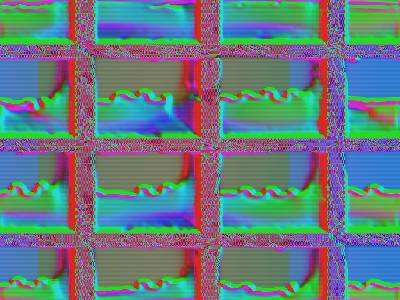 | [**vibrant-rd**](vibrant-rd.html) · [js](vibrant-rd.js)  | WebGL2 / three.js |  | repo_script_js5_code |
| 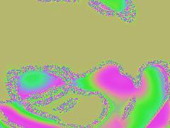 | [**vibrant_rd**](vibrant_rd.html) · [js](vibrant_rd.js)  | WebGL2 / three.js |  | repo_script_js5_code |
| 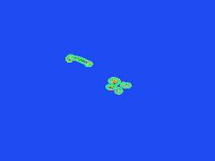 | [**vivid-diffusion**](vivid-diffusion.html) · [js](vivid-diffusion.js) Fixed simulation resolution · Feral chaotic injection seed · SIMULATION SHADER (Gray-Scott + Advection) | WebGL2 / three.js |  | repo_script_js5_code |
| 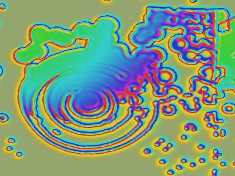 | [**vivid-rd**](vivid-rd.html) · [js](vivid-rd.js) Seed rings and chaotic noise · Domain warped mapping of Munafo&#x27;s parameter space · Pushes the simulation through Spots (δ), Worms (μ), and U-Skate (π) | WebGL2 / three.js |  | repo_script_js5_code |
| 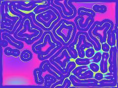 | [**wild-diffusion**](wild-diffusion.html) · [js](wild-diffusion.js) Ping-pong targets for RD simulation · INITIALIZATION SHADER: Dense random seeding · High frequency noise for seeding | WebGL2 / three.js |  | repo_script_js5_code |
| 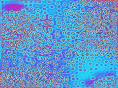 | [**wild_diffusion**](wild_diffusion.html) · [js](wild_diffusion.js) Drifting parameter space to force constant mutation · Interpolate between Coral Growth (0.0545, 0.062) and Turing Spots (0.030, 0.055) · Mouse injection logic | WebGL2 / three.js |  | repo_script_js5_code |
