# 03 · Cellular automata, Lenia & sandpiles

**What's in here:** Game-of-Life-likes, continuous CA (Lenia), cyclic CA, Abelian sandpiles, WFC-ish grids.

**The idea in one breath:** Every pixel is a cell that looks at its neighbors and follows a rule. Tiny rules, emergent creatures. Sandpiles: grains pile up until they topple in avalanches.

23 designs. Each is a pair: open the `.html` in any browser (self-contained, no server); the `.js` is the raw sketch source.

| | Design | Renderer | Notes | From |
|---|---|---|---|---|
| 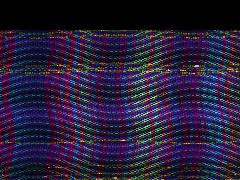 | [**ca-tartan**](ca-tartan.html) · [js](ca-tartan.js) Number of threads in the weave · CA State Arrays · Hash function for fibers | WebGL2 / three.js |  | repo_script_js5_code |
| 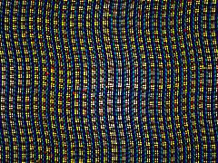 | [**ca_tartan**](ca_tartan.html) · [js](ca_tartan.js)  | WebGL2 / three.js |  | repo_script_js5_code |
| 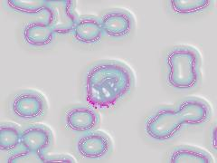 | [**candy-lenia**](candy-lenia.html) · [js](candy-lenia.js)  | WebGL2 / three.js |  | repo_script_js5_code |
| 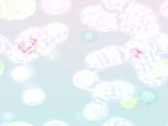 | [**candy_lenia**](candy_lenia.html) · [js](candy_lenia.js) Advection current for traces · Saturated Cyan | WebGL2 / three.js |  | repo_script_js5_code repo_script_js5_code |
| 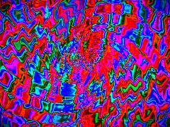 | [**codesoup_20260704_081531**](codesoup_20260704_081531.html) · [js](codesoup_20260704_081531.js) HASH &amp; NOISE (Acoustic Speckle / Grain) · CHLADNI VIBRATION (from &#x27;vibration&#x27; repo) · MOIRÉ SPIRAL (from &#x27;moire&#x27; repo) | WebGL2 / three.js |  | shaderfiles3 |
| 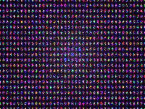 | [**github-dynamic-art**](github-dynamic-art.html) · [js](github-dynamic-art.js) Create a bounded simulation resolution for performance · FUNGAL COMPUTE: Continuous Cellular Automata Shader · Inherits logic from cellular_automata repo (Lenia/Cyclic hybrids) | WebGL2 / three.js |  | repo_script_js5_code |
| 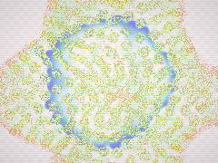 | [**lenia-lace**](lenia-lace.html) · [js](lenia-lace.js) 1. SEED SHADER: Generates the initial Quasicrystal / Tessellation brocade · p6m Quasicrystal Fold · Interference patterns | WebGL2 / three.js |  | repo_script_js5_code |
| 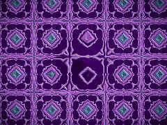 | [**lenia-velvet-damask**](lenia-velvet-damask.html) · [js](lenia-velvet-damask.js) Generates the Lenia-style cellular damask pattern · Slowly unroll the fabric · Damask mirrored folding (p4m wallpaper group symmetry) | WebGL2 / three.js |  | repo_script_js5_code |
| 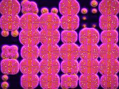 | [**lenia_velvet_damask**](lenia_velvet_damask.html) · [js](lenia_velvet_damask.js) Initialization · 9-tap Laplacian for smoother, Lenia-like organic curves · Gray-Scott parameters tuned for intricate Damask mazes | WebGL2 / three.js |  | repo_script_js5_code |
| 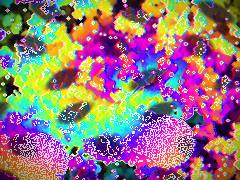 | [**neon-life**](neon-life.html) · [js](neon-life.js) Seed initial CA state · R: Alive state · A: Random seed | WebGL2 / three.js |  | repo_script_js5_code |
| 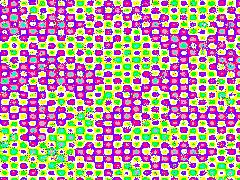 | [**neon_media_rot**](neon_media_rot.html) · [js](neon_media_rot.js) PASS 1: LENIA INFECTION ENGINE · A continuous cellular automaton acting as the biological foundation of the glitch. · Multi-kernel sampling ring (simplified for performance) | WebGL2 / three.js |  | repo_script_js5_code repo_script_js5_code |
| 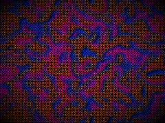 | [**RepoArt**](RepoArt.html) · [js](RepoArt.js) Curl advection domain warp · 3x3 Neighborhood sampling for diffusion · Continuous Cyclic Cellular Automaton (May-Leonard model variant) | WebGL2 / three.js |  | repo_script_js5_code |
| 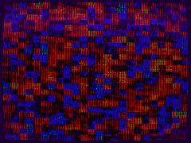 | [**spectral_candy_avalanche_20260624_102909**](spectral_candy_avalanche_20260624_102909.html) · [js](spectral_candy_avalanche_20260624_102909.js) SIMULATION SHADER · Abelian Sandpile logic · Continuous background injection (avalanche driver) | WebGL2 / three.js |  | shader_files_2 |
| 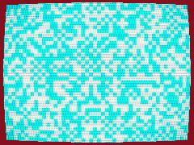 | [**spectral_candy_avalanche_20260624_115928**](spectral_candy_avalanche_20260624_115928.html) · [js](spectral_candy_avalanche_20260624_115928.js) Render Targets (Ping-Pong) · Shared GLSL Chunks · 1. Simulation Shader (Sandpile + WFC Entropy) | WebGL2 / three.js |  | shader_files_2 |
| 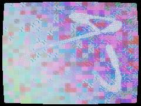 | [**spectral_candy_avalanche_20260624_181540**](spectral_candy_avalanche_20260624_181540.html) · [js](spectral_candy_avalanche_20260624_181540.js) 2. Render Pass · 3. Memory Pass | WebGL2 / three.js |  | shader_files_2 shader_files_2 |
| 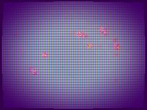 | [**spectral_candy_avalanche_garden_20260624_105359**](spectral_candy_avalanche_garden_20260624_105359.html) · [js](spectral_candy_avalanche_garden_20260624_105359.js) Render targets for ping-pong · WFC CPU Data Texture · Common Vertex Shader | WebGL2 / three.js |  | shader_files_2 |
| 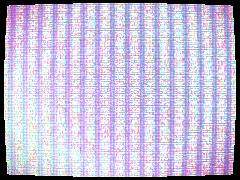 | [**spectral_candy_avalanche_garden_20260624_134640**](spectral_candy_avalanche_garden_20260624_134640.html) · [js](spectral_candy_avalanche_garden_20260624_134640.js) Resolution for the simulation grid (WFC + Sandpile) · SIMULATION PASS (Sandpile + WFC Fake) · r: grains, g: entropy, b: tile type, a: energy/heat | WebGL2 / three.js |  | shader_files_2 shader_files_2 shader_files_2 |
| 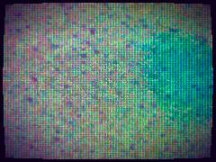 | [**spectral_candy_garden_20260624_111014**](spectral_candy_garden_20260624_111014.html) · [js](spectral_candy_garden_20260624_111014.js) Core GLSL Library containing Spectral Color (Wyman fit), OKLab conversions, and Thin-Film interference · OKLab Conversions (from color_systems) · Spectral Color Wyman Fit (from spectral_color) | WebGL2 / three.js |  | shader_files_2 |
| 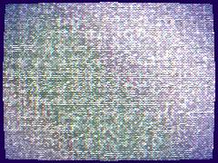 | [**spectral_candy_garden_20260624_135127**](spectral_candy_garden_20260624_135127.html) · [js](spectral_candy_garden_20260624_135127.js) Resolution for the Sandpile/WFC Grid (keeps tiles square) · Render Targets · Shared OKLab &amp; Color Math | WebGL2 / three.js |  | shader_files_2 shader_files_2 |
| 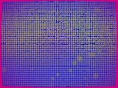 | [**spectral_candy_garden_20260624_175927**](spectral_candy_garden_20260624_175927.html) · [js](spectral_candy_garden_20260624_175927.js) Continuous avalanche seeding · Mouse interaction · Reseed WFC/Sandpile | WebGL2 / three.js |  | shader_files_2 shader_files_2 |
| 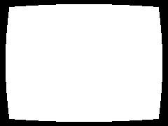 | [**spectral_candy_garden_20260624_180948**](spectral_candy_garden_20260624_180948.html) · [js](spectral_candy_garden_20260624_180948.js) Spectral Candy | WebGL2 / three.js | static/slow | shader_files_2 |
| 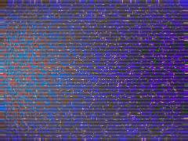 | [**spectral_candy_garden_20260625_173808**](spectral_candy_garden_20260625_173808.html) · [js](spectral_candy_garden_20260625_173808.js) Clean up previous event listeners if they exist to prevent memory leaks during HMR · STATE MANAGEMENT · GLSL SHADER CHUNKS | WebGL2 / three.js |  | shader_files_2 |
| 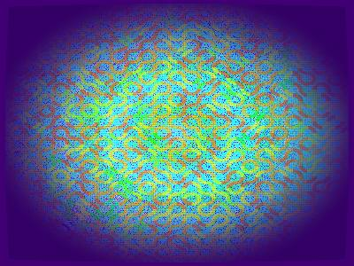 | [**spectral_candy_garden_20260626_151932**](spectral_candy_garden_20260626_151932.html) · [js](spectral_candy_garden_20260626_151932.js) Deep saturated base, no black · Vibrant boundary | WebGL2 / three.js |  | shader_files_2 |
