# 04 · Agent systems: slime mold, mycelium, flocking

**What's in here:** Physarum trail agents, hyphal tip growth & anastomosis, boids/murmurations.

**The idea in one breath:** Thousands of dumb little walkers leave trails and follow each other's scent. Together they draw networks that look alive.

23 designs. Each is a pair: open the `.html` in any browser (self-contained, no server); the `.js` is the raw sketch source.

| | Design | Renderer | Notes | From |
|---|---|---|---|---|
| 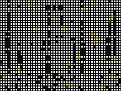 | [**acid-slime**](acid-slime.html) · [js](acid-slime.js) Lifecycle: 20-second cycle · Kill all tips instantly · Agent Update (Orthogonal Slime Mold routing) | Canvas 2D |  | repo_script_js5_code |
| 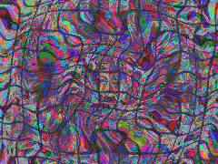 | [**colorful-fungal_20260617_155408**](colorful-fungal_20260617_155408.html) · [js](colorful-fungal_20260617_155408.js) Fractional Brownian Motion for Mycelial Growth · OKLCh to sRGB Conversion (color_systems integration) · Structural Color: Thin-Film Interference | WebGL2 / three.js |  | shader_files_2 shader_files_2 |
| 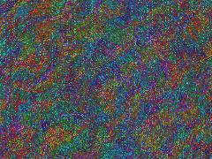 | [**colorful-fungal_20260618_102219**](colorful-fungal_20260618_102219.html) · [js](colorful-fungal_20260618_102219.js)  | WebGL2 / three.js |  | shader_files_2 shader_files_2 |
| 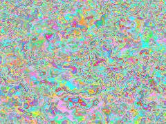 | [**colorful-fungi_20260617_154517**](colorful-fungi_20260617_154517.html) · [js](colorful-fungi_20260617_154517.js) OKLCh to sRGB conversion for hyper-vivid, perceptually uniform colors · Pseudo-random hashing · Fractional Brownian Motion (FBM) | WebGL2 / three.js |  | shader_files_2 |
| 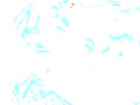 | [**colorful-fungi_20260617_155031**](colorful-fungi_20260617_155031.html) · [js](colorful-fungi_20260617_155031.js) THE FERAL FUNGAL ENGINE: ENZYMATIC GEMATRIA ROT · 1. Mycelial Networks (Branching ridges, Anastomosis nodes, Laccase bleed) · 2. Structural Color (Thin-film iridescence on hyphal cords) | WebGL2 / three.js |  | shader_files_2 |
| 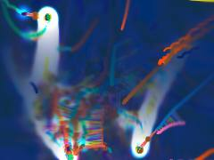 | [**colorful-fungi_20260617_164501**](colorful-fungi_20260617_164501.html) · [js](colorful-fungi_20260617_164501.js) RISO Spot Colors (Strictly NO Black or White) · Structural Color / Thin Film gradients (simulated) · Math Constants from Dream Physics &amp; Color Systems | Canvas 2D |  | shader_files_2 shader_files_2 |
| 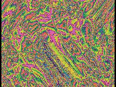 | [**colorful-mycelium_20260617_164029**](colorful-mycelium_20260617_164029.html) · [js](colorful-mycelium_20260617_164029.js) Hash and noise functions for fungal anastomosis · Worley noise generating the mycelial network (from Mycelial Networks repo) · Animate the network nodes | WebGL2 / three.js |  | shader_files_2 |
| 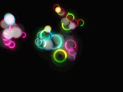 | [**colorful_fungi_20260617_094948**](colorful_fungi_20260617_094948.html) · [js](colorful_fungi_20260617_094948.js) Fungal Math &amp; Constants · 137.5 degrees in radians · Slow enzymatic decay (white rot lace effect) | Canvas 2D |  | shader_files_2 |
| 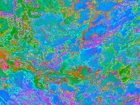 | [**cool_20260617_160949**](cool_20260617_160949.html) · [js](cool_20260617_160949.js) Gematria Resonances · COLOR SYSTEMS (OKLCh to sRGB) · FERAL CONSTRAINT: NO BLACK, NO WHITE, NO EMPTY GRAY | WebGL2 / three.js |  | shader_files_2 shader_files_2 |
| 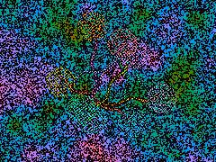 | [**dreamtime-fungi_20260617_134404**](dreamtime-fungi_20260617_134404.html) · [js](dreamtime-fungi_20260617_134404.js) ALCHEMICAL MATH &amp; HASHES · Fractal Brownian Motion (Domain Warping / Fungal Substrate) · COLOR SYSTEMS (OKLab / Perceptual Math) | WebGL2 / three.js |  | shader_files_2 shader_files_2 |
| 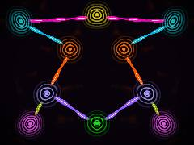 | [**dreamtime-fungi_20260617_140252**](dreamtime-fungi_20260617_140252.html) · [js](dreamtime-fungi_20260617_140252.js) Perceptual Color Math (OKLCh to sRGB) · Noise &amp; FBM (Fractal Logic) · Map to aspect ratio centered at 0.5 | WebGL2 / three.js |  | shader_files_2 |
| 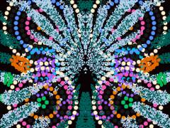 | [**dreamtime_fungi_20260617_111348**](dreamtime_fungi_20260617_111348.html) · [js](dreamtime_fungi_20260617_111348.js) THE MYCELIAL DREAMTIME MAP · A feral fusion of Australian Aboriginal visual grammar (dot painting, · concentric rings, meandering tracks, bilateral symmetry) with the | Canvas 2D |  | shader_files_2 |
| 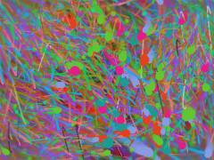 | [**dynamic-fungal_20260618_100132**](dynamic-fungal_20260618_100132.html) · [js](dynamic-fungal_20260618_100132.js) Strict clamp to absolutely forbid black and white (keep between 30 and 225) · OKLab to RGB for perceptual, vibrant, non-muddy colors · Structural Color (Thin Film Interference - Bragg Reflection) | Canvas 2D | ⚠️ throws occasional errors | shader_files_2 |
| 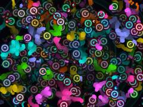 | [**dynamic-fungi_20260617_101924**](dynamic-fungi_20260617_101924.html) · [js](dynamic-fungi_20260617_101924.js) FERAL DESIGN BRAIN INIT · System: Mycelial Voronoi Minkowski Morphing + Horror Vacui Crayon + Op Art Interference · OKLCh to sRGB conversion for perceptually uniform acid palettes | Canvas 2D |  | shader_files_2 |
| 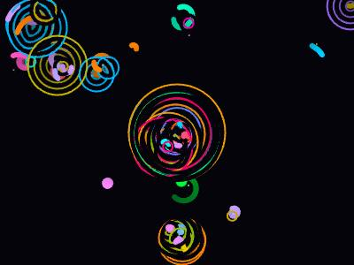 | [**dynamic-fungi_20260617_110643**](dynamic-fungi_20260617_110643.html) · [js](dynamic-fungi_20260617_110643.js)  | Canvas 2D |  | shader_files_2 |
| 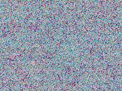 | [**dynamic-fungi_20260617_163150**](dynamic-fungi_20260617_163150.html) · [js](dynamic-fungi_20260617_163150.js) ALCHEMICAL MATH &amp; NOISE · Hardware entropy/noise · Mycological Voronoi (Spores / Cleistothecia) | WebGL2 / three.js |  | shader_files_2 |
| 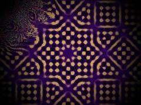 | [**interactive-art**](interactive-art.html) · [js](interactive-art.js)  | WebGL2 / three.js |  | repo_script_js5_code |
| 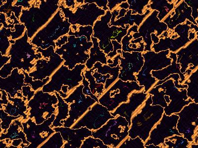 | [**outsider-fungi_20260617_140746**](outsider-fungi_20260617_140746.html) · [js](outsider-fungi_20260617_140746.js) OUTSIDER MATH &amp; NOISE · COLOR SYSTEMS: OKLab to sRGB · GOLDEN ANGLE PALETTE | WebGL2 / three.js |  | shader_files_2 |
| 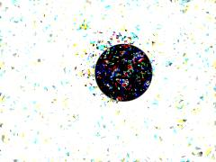 | [**rainbow-flock**](rainbow-flock.html) · [js](rainbow-flock.js) THE WEIRD CODE GUY - FERAL DESIGN BRAIN · INITIATING: &quot;Scale-Free Birefringence Murmuration&quot; · REJECTING: Standard 2D triangle boids with flat colors. | Canvas 2D |  | repo_script_js5_code |
| 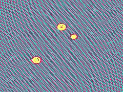 | [**slime-moire**](slime-moire.html) · [js](slime-moire.js)  | WebGL2 / three.js |  | repo_script_js5_code |
| 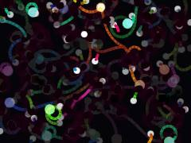 | [**vibrant-fungi_20260617_153957**](vibrant-fungi_20260617_153957.html) · [js](vibrant-fungi_20260617_153957.js) [THE WEIRD CODE GUY] - FERAL DESIGN-BRAIN: ACTIVE · MECHANISM: Autophagic Sectoring &amp; Enzymatic Moiré · BIOLOGY: Mycelial networks don&#x27;t just grow; they fuse (anastomosis), | Canvas 2D |  | shader_files_2 |
| 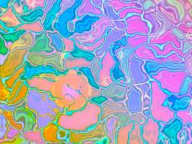 | [**vibrant-fungi_20260617_154203**](vibrant-fungi_20260617_154203.html) · [js](vibrant-fungi_20260617_154203.js) OKLab Color Space Functions · Noise &amp; Math Helpers · Fungal/Cellular Voronoi | WebGL2 / three.js |  | shader_files_2 |
| 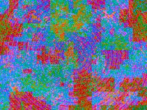 | [**vibrant-fungi_20260618_101226**](vibrant-fungi_20260618_101226.html) · [js](vibrant-fungi_20260618_101226.js) MATH &amp; NOISE UTILS · Curl noise for &quot;Semantic Font Rot&quot; / Fluid distortion · Voronoi for Mycelial Anastomosis &amp; Sectoring | WebGL2 / three.js |  | shader_files_2 |
