# 05 · Noise, flow & fluid fields

**What's in here:** fBm / Perlin / simplex noise, domain warping, curl-noise advection, Voronoi-ish 'substances'.

**The idea in one breath:** Smooth random hills stacked at many scales (fBm), then use one noise field to bend the coordinates of another (domain warping) = marble, smoke, liquid.

20 designs. Each is a pair: open the `.html` in any browser (self-contained, no server); the `.js` is the raw sketch source.

| | Design | Renderer | Notes | From |
|---|---|---|---|---|
| 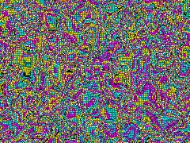 | [**acid-material**](acid-material.html) · [js](acid-material.js) Ashima 3D Simplex Noise · Three simultaneous time scales · Global geologic drift | WebGL2 / three.js |  | repo_script_js5_code |
| 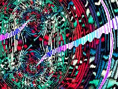 | [**acid-warp**](acid-warp.html) · [js](acid-warp.js)  | Canvas 2D |  | repo_script_js5_code |
| 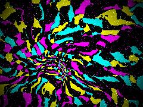 | [**art_20260611_154607**](art_20260611_154607.html) · [js](art_20260611_154607.js)  | WebGL2 / three.js |  | shader_files_2 |
| 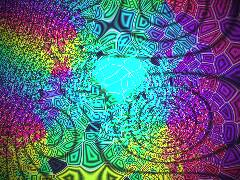 | [**art_20260709_142745**](art_20260709_142745.html) · [js](art_20260709_142745.js) NEON TRASH ORACLE WEATHER SYSTEM · A maximalist living interface forged from the DNA of 13 repositories: · Plateau Foam &amp; Tessellations: Voronoi boundaries and structural cell limits. | WebGL2 / three.js |  | shaderfiles3 |
| 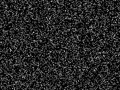 | [**inspo**](inspo.html) · [js](inspo.js) Resolution of the infection · THE INVASIVE COORDINATE OF PSYCHIC INTRUSION · LOGIC OF THE VOID: Every Spore evaluates its neighbors for &quot;Entropy&quot; | Canvas 2D |  | repo_script_js5_code |
| 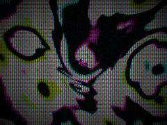 | [**neon-grain_20260629_122407**](neon-grain_20260629_122407.html) · [js](neon-grain_20260629_122407.js) Fast hash for electrostatic grain · 2D Rotation matrix · Feral Hyperbolic Gyroid Field | WebGL2 / three.js |  | shader_files_2 |
| 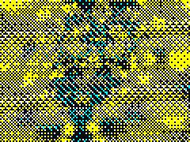 | [**neon-material**](neon-material.html) · [js](neon-material.js)  | Canvas 2D |  | repo_script_js5_code |
| 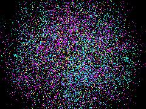 | [**neon-matter**](neon-matter.html) · [js](neon-matter.js) Antialiasing off to preserve raw dither pixelation · Bypass projection matrices for a direct full-screen quad · 3D Hash &amp; Noise for FBM | WebGL2 / three.js |  | repo_script_js5_code |
| 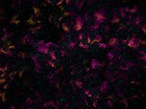 | [**neon-substance**](neon-substance.html) · [js](neon-substance.js) Hash function for pseudo-randomness · 2D Value Noise · Fractional Brownian Motion (FBM) | WebGL2 / three.js |  | repo_script_js5_code |
| 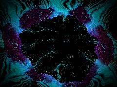 | [**neon-substance_20260625_155136**](neon-substance_20260625_155136.html) · [js](neon-substance_20260625_155136.js) Raw noise (Bilinear interpolation on hash grid) · Fractional Brownian Motion (Substrate domain) · Normalize coordinates &amp; aspect ratio | WebGL2 / three.js |  | shader_files_2 |
| 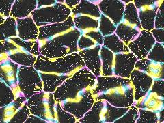 | [**neon-void-grain**](neon-void-grain.html) · [js](neon-void-grain.js) Hash &amp; Noise Functions · Crackle Network (Anisotropic Voronoi) · Adapted from resist_dye_patterns (wax crackle) and mycelial_networks (anastomosis) | WebGL2 / three.js |  | repo_script_js5_code |
| 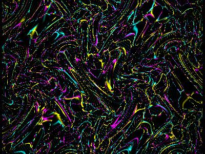 | [**neon-void-material**](neon-void-material.html) · [js](neon-void-material.js) The Three Time Scales · Slow: Global tectonic drift &amp; domain warping · Med: Structural cleavage growth &amp; fluid advection | WebGL2 / three.js |  | repo_script_js5_code |
| 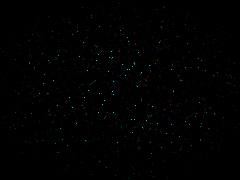 | [**neon-void-substance**](neon-void-substance.html) · [js](neon-void-substance.js) Feral Math: Hash &amp; Noise Primitives · Lithogenesis &amp; Morphogenesis: Structural Scalar Field · Machine Hesitation: Horizontal sync glitch logic | WebGL2 / three.js |  | repo_script_js5_code |
| 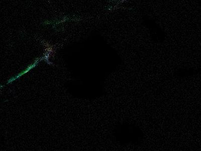 | [**neon-void-texture**](neon-void-texture.html) · [js](neon-void-texture.js)  | WebGL2 / three.js |  | repo_script_js5_code |
| 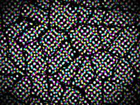 | [**neon_substance**](neon_substance.html) · [js](neon_substance.js) Feral Math: Hash functions · Continuous Gradient Noise · Slow Time: Domain Warping FBM (The Fungal Membrane) | WebGL2 / three.js |  | repo_script_js5_code |
| 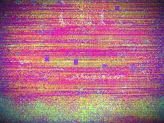 | [**repo-chroma-soup_20260701_223130**](repo-chroma-soup_20260701_223130.html) · [js](repo-chroma-soup_20260701_223130.js) Log-Polar Cortical Dipole (Phosphene / Op Art) · Neighborhood sampling · Laplacian (Diffusion &amp; Lateral Suppression) | WebGL2 / three.js |  | shader_files_2 |
| 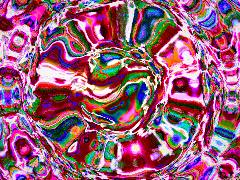 | [**repo-chroma-soup_20260702_233811**](repo-chroma-soup_20260702_233811.html) · [js](repo-chroma-soup_20260702_233811.js)  | WebGL2 / three.js |  | shaderfiles3 |
| 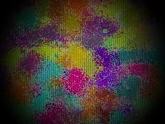 | [**repo-chroma-soup_20260704_064436**](repo-chroma-soup_20260704_064436.html) · [js](repo-chroma-soup_20260704_064436.js)  | WebGL2 / three.js |  | shaderfiles3 |
| 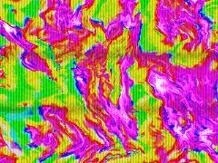 | [**repo-chroma-soup_20260704_064802**](repo-chroma-soup_20260704_064802.html) · [js](repo-chroma-soup_20260704_064802.js) CORE MATH: Hash and Value Noise (Foam / Mycelial / Lenia / Datamosh) · FBM: Multi-scale fluid warping · CROSS-PROCESSING: Photographic S-Curve Contrast | WebGL2 / three.js |  | shaderfiles3 |
| 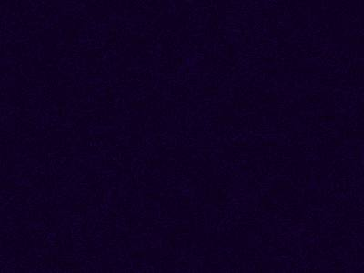 | [**violet-curl-waves**](violet-curl-waves.html) · [js](violet-curl-waves.js) Ashima 3D Simplex Noise · Merry&#x27;s Interference Palette · Centered, aspect-corrected coordinates | WebGL2 / three.js |  | repo_script_js5_code |
