# 06 · Tilings, Voronoi & weaving

**What's in here:** Voronoi/Worley cells, foams, Islamic/girih tilings, warp-and-weft textiles, ikat, jacquard.

**The idea in one breath:** Carve the plane into cells (nearest-seed = Voronoi) or interlock repeating tiles and threads. Computational geometry meets the loom.

15 designs. Each is a pair: open the `.html` in any browser (self-contained, no server); the `.js` is the raw sketch source.

| | Design | Renderer | Notes | From |
|---|---|---|---|---|
| 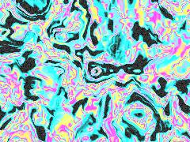 | [**acid-grain**](acid-grain.html) · [js](acid-grain.js) Feral Hash Generators · 3D Noise for smooth manifolds · Mycological Voronoi (Minkowski morphing + L-Infinity bias) | WebGL2 / three.js |  | repo_script_js5_code |
| 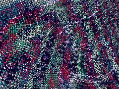 | [**acid-textile**](acid-textile.html) · [js](acid-textile.js) Kleinian / Hyperbolic Math · Procedural Noise · Lisa Frank / Neon Acid Palette | WebGL2 / three.js |  | repo_script_js5_code |
| 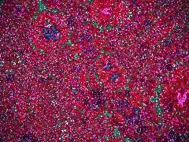 | [**acid-weave**](acid-weave.html) · [js](acid-weave.js) Complex math for Kleinian/Mobius folds · Hash and Noise for Batik Crackle and Ikat Bleed · Neon Acid Palette (from color_fields/cosine_palette) | WebGL2 / three.js |  | repo_script_js5_code |
| 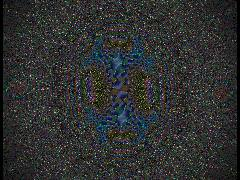 | [**acidic-textile**](acidic-textile.html) · [js](acidic-textile.js) Mathematical &amp; Feral Noise · Acidic Toxic Palettes · Autophagic Weave Topology | WebGL2 / three.js |  | repo_script_js5_code |
| 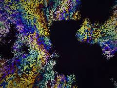 | [**acidic-warp**](acidic-warp.html) · [js](acidic-warp.js) The Feral Jacquard Loom: A mathematically corrupted, highly acidic textile engine. · Combines domain warping, bitwise XOR fractals, anisotropic thread shading, · and structural lace burnout. | WebGL2 / three.js |  | repo_script_js5_code repo_script_js5_code |
| 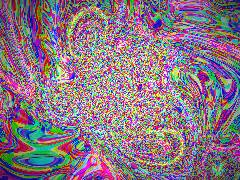 | [**computational-soup_20260702_232716**](computational-soup_20260702_232716.html) · [js](computational-soup_20260702_232716.js) Complex Math (domain_coloring) · Hash for Voronoi · Weaire-Phelan / Foam approximation (plateau_foam) | WebGL2 / three.js |  | shader_files_2 shader_files_2 |
| 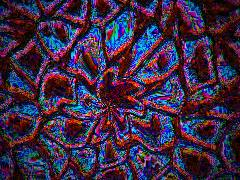 | [**computational-soup_20260704_193147**](computational-soup_20260704_193147.html) · [js](computational-soup_20260704_193147.js) Plateau Foam (Voronoi Relaxation) · Temporal desync / relaxation · Master Scene: Coherent Computational Soup | WebGL2 / three.js |  | shaderfiles3 shaderfiles3 |
| 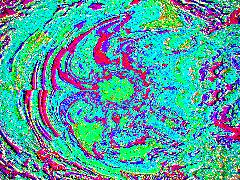 | [**computational-soup_20260704_200344**](computational-soup_20260704_200344.html) · [js](computational-soup_20260704_200344.js) ALCHEMY &amp; PRNG · NOISE &amp; FBM (Mycelial Advection) · PLATEAU FOAM / WEAIRE-PHELAN | WebGL2 / three.js |  | shaderfiles3 shaderfiles3 |
| 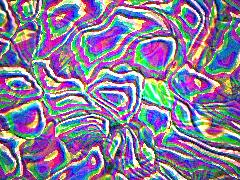 | [**computational_soup_20260704_202759**](computational_soup_20260704_202759.html) · [js](computational_soup_20260704_202759.js) Mathematical Primitives &amp; Hashing · Domain warping via FBM (Acoustic Impedance / Lenia flow) · Topological Structures | WebGL2 / three.js |  | shaderfiles3 shaderfiles3 |
| 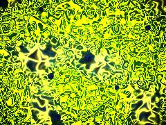 | [**islamic-pattern**](islamic-pattern.html) · [js](islamic-pattern.js) OKLab Perceptual Color Math (color_systems) · Noise &amp; Domain Warp (noise_fields) · Fungal animation | WebGL2 / three.js |  | repo_script_js5_code |
| 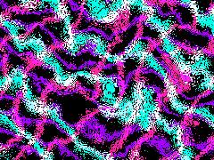 | [**living-fabric**](living-fabric.html) · [js](living-fabric.js) CORE MATH &amp; NOISE (THE WET ENGINE) · 5-octave FBM for the living fabric domain warp · MOIRE / HALFTONE DOT FUNCTION | WebGL2 / three.js |  | repo_script_js5_code |
| 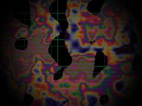 | [**math-textile**](math-textile.html) · [js](math-textile.js) [GLITCH PROPHET] Deterministic hardware confusion · Noise for resist dye diffusion · [STRUCTURAL COLOR] Physics-based spectral interference mapping | WebGL2 / three.js |  | repo_script_js5_code |
| 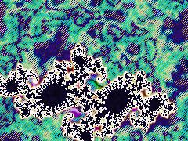 | [**math-weave**](math-weave.html) · [js](math-weave.js) Hash &amp; FBM for Fiber Microstructure &amp; Hyperbolic Warp · Oklch to sRGB (Perceptual Color Space from color_systems repo) · Black Body Radiation (from color_fields repo) | WebGL2 / three.js |  | repo_script_js5_code |
| 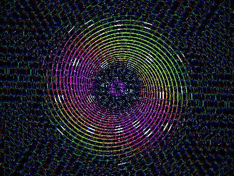 | [**math_blueprint**](math_blueprint.html) · [js](math_blueprint.js) STRUCTURAL COLOR PALETTE (Repo 3) · HEXAGONAL TESSELLATION (Repo 4) · MOIRÉ SPIRAL PHANTOMS (Repo 2) | WebGL2 / three.js |  | repo_script_js5_code |
| 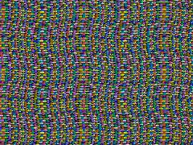 | [**math_weave**](math_weave.html) · [js](math_weave.js) FERAL HYBRID MECHANISM: · We are building a &quot;Julia Jacquard Loom&quot;. · It weaves a physical fabric (warp &amp; weft cylinders) where the interlacing | WebGL2 / three.js |  | repo_script_js5_code |
