# 07 · Quasicrystals & aperiodic order

**What's in here:** Sums of N plane waves (5-, 7-, 8-, 12-fold), Penrose / Ammann-Beenker, cut-and-project from 5D.

**The idea in one breath:** Ordered but never repeating. Add up waves pointing in 5+ directions and you get a pattern with forbidden symmetry—the math of Penrose tiles.

20 designs. Each is a pair: open the `.html` in any browser (self-contained, no server); the `.js` is the raw sketch source.

| | Design | Renderer | Notes | From |
|---|---|---|---|---|
| 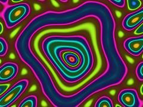 | [**aperiodic_flux**](aperiodic_flux.html) · [js](aperiodic_flux.js) Cycle logic: 12 second period · df = Dissolution Factor (0 = Order, 1 = Dissolution) · Precompute 8-fold Ammann-Beenker wave vectors for quasicrystal interference | Canvas 2D |  | repo_script_js5_code |
| 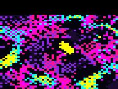 | [**git-flow**](git-flow.html) · [js](git-flow.js) FERAL DESIGN MECHANISM: &quot;Aperiodic Ditherpunk Diffraction Bloom&quot; · Fuses the rigorous 5-fold wave interference of quasicrystals (quasicrystals repo) · with brutalist pixel-locked screen-space dithering (pixel_voxel repo) | WebGL2 / three.js |  | repo_script_js5_code |
| 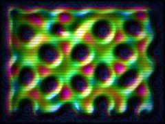 | [**github-dynamic**](github-dynamic.html) · [js](github-dynamic.js) Set alpha channel once for performance · Seed initial state based on an 8-fold Ammann-Beenker quasicrystal lattice · Inject organic matter along the mathematical ridges | Canvas 2D |  | repo_script_js5_code |
| 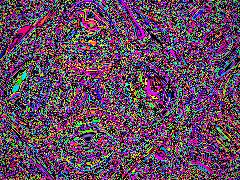 | [**kiyo-quasicrystal**](kiyo-quasicrystal.html) · [js](kiyo-quasicrystal.js) 5-fold symmetry for Penrose/Aperiodic Quasicrystal · Lisa Frank / Maximalist Chromatics (Repo 3) · Domain Warping via Clifford Attractor (Repo 4) | WebGL2 / three.js |  | repo_script_js5_code |
| 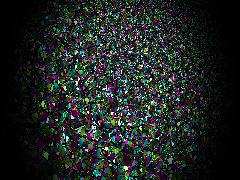 | [**neon_quasicrystal**](neon_quasicrystal.html) · [js](neon_quasicrystal.js) Complex arithmetic for Mobius transform · Void black background falloff · 1. Medium Drift: Mobius Transform (Alchemical L07) | WebGL2 / three.js |  | repo_script_js5_code |
| 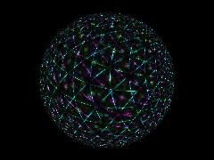 | [**quasicrystal**](quasicrystal.html) · [js](quasicrystal.js) Safe hyperbolic arctangent for projective unrolling · Feral neon palette: Cyan, Magenta, Yellow-Green · Complex math for Mobius translation | WebGL2 / three.js |  | repo_script_js5_code |
| 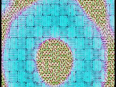 | [**quasicrystal-brocade**](quasicrystal-brocade.html) · [js](quasicrystal-brocade.js) Generates the quasicrystal heightfield, thread structure, and embroidery mask · 12-fold Quasicrystal mathematical loom · Gentle phase drift to make the pattern alive | WebGL2 / three.js |  | repo_script_js5_code |
| 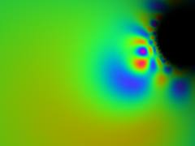 | [**quasicrystal-dissolve**](quasicrystal-dissolve.html) · [js](quasicrystal-dissolve.js) ALCHEMICAL MATH: MÖBIUS TRANSFORMS · CRYSTALLINE ORDER: FULL SPECTRUM PALETTE · QUASICRYSTAL / INCOMMENSURATE FREQUENCIES | WebGL2 / three.js |  | repo_script_js5_code |
| 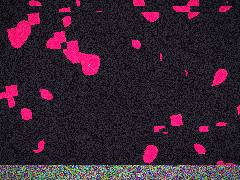 | [**quasicrystal-oscillator**](quasicrystal-oscillator.html) · [js](quasicrystal-oscillator.js)  | WebGL2 / three.js |  | repo_script_js5_code |
| 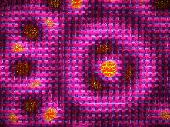 | [**quasicrystal_brocade**](quasicrystal_brocade.html) · [js](quasicrystal_brocade.js) 7-Fold Quasicrystal Wave Summation · Structural Color / Thin-film Palette · Procedural height map for the brocade loom | WebGL2 / three.js |  | repo_script_js5_code |
| 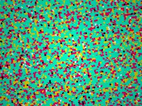 | [**quasicrystal_cycle**](quasicrystal_cycle.html) · [js](quasicrystal_cycle.js)  | WebGL2 / three.js |  | repo_script_js5_code |
| 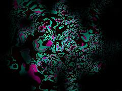 | [**quasicrystal_flux**](quasicrystal_flux.html) · [js](quasicrystal_flux.js) [Kiyoshi-Absorber: Noneuclidean] · Complex division and multiplication for Möbius transformation · T(z) = (z - a) / (1 - conj(a)*z) -&gt; maps a to origin, preserves unit disk | WebGL2 / three.js |  | repo_script_js5_code |
| 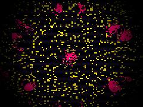 | [**quasicycle**](quasicycle.html) · [js](quasicycle.js) Chaos / Hash functions · Quasicrystal projection (5-fold Penrose basis) · Quasicrystal projection (8-fold Ammann-Beenker basis) | WebGL2 / three.js |  | repo_script_js5_code |
| 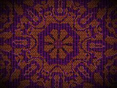 | [**quasifunk**](quasifunk.html) · [js](quasifunk.js) Plane waves mapped with Silver Ratio for Ammann-Beenker structure · Cyberdelic Neon / Acid Vibration Palette · Deep Violet Black | WebGL2 / three.js |  | repo_script_js5_code |
| 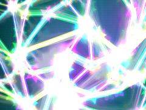 | [**repo-fusion**](repo-fusion.html) · [js](repo-fusion.js) Generate Lisa Frank offscreen sprites on first run for massive performance · Magenta / Cyan · Yellow / Magenta | Canvas 2D |  | repo_script_js5_code |
| 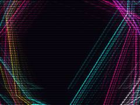 | [**repo-visual**](repo-visual.html) · [js](repo-visual.js) Generate Fibonacci Word for Aperiodic Tiling (1D Quasicrystal projection) · 1. TEMPORAL ECHO (Phosphor Noir Background) · Clear offscreen for fresh geometry | Canvas 2D |  | repo_script_js5_code |
| 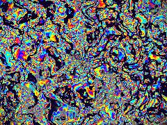 | [**repo-viz**](repo-viz.html) · [js](repo-viz.js) Full screen quad · Golden Ratio for Quasicrystal scaling · Hash functions | WebGL2 / three.js |  | repo_script_js5_code |
| 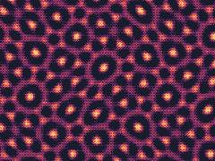 | [**synergy**](synergy.html) · [js](synergy.js) THE MECHANISM: Phason-Corrupted 5D Cut-and-Project Ditherpunk · We simulate the continuous density field of a 5D hypercubic lattice projected to 2D. · We then infect it with a strict Bayer 4x4 dither and force it through a 5-color biological palette. | WebGL2 / three.js |  | repo_script_js5_code |
| 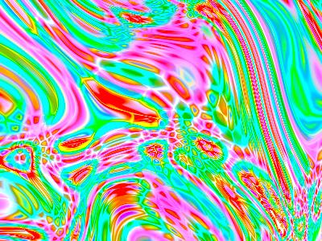 | [**vivid-maximalist**](vivid-maximalist.html) · [js](vivid-maximalist.js) Mathematical constants from Quasicrystals repo · NOISE FIELDS DNA · Worley F2-F1 (Cellular Leather / Crystal Facets) | WebGL2 / three.js |  | repo_script_js5_code |
| 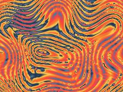 | [**vivid_maximalist**](vivid_maximalist.html) · [js](vivid_maximalist.js) THE STRANGE MECHANISM: Thermal Bloom Moiré on an Aperiodic Manifold · Combines Quasicrystal projection math (5/8/12 fold), Moiré frequency interference, · and a strict Retrofuturist &quot;Raygun Gothic&quot; palette (no black/white, maximal color). | WebGL2 / three.js |  | repo_script_js5_code |
