# 08 · Waves, interference & moiré

**What's in here:** Moiré gratings, beat frequencies, Chladni/cymatics plates, LED-subpixel interference, ripples.

**The idea in one breath:** Overlay two almost-identical patterns and a third, ghost pattern appears in the mismatch. Same physics as sound beats and vibrating sand plates.

23 designs. Each is a pair: open the `.html` in any browser (self-contained, no server); the `.js` is the raw sketch source.

| | Design | Renderer | Notes | From |
|---|---|---|---|---|
| 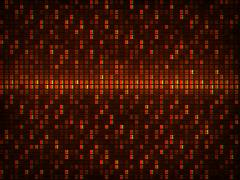 | [**amber_ripple**](amber_ripple.html) · [js](amber_ripple.js) Horizontal tearing (Broadcast Signal Failure / Sync Instability) · Refresh wave (CRT scanline over-excitation) · Wave / Sinusoidal Moiré (Soft Interference) | Canvas 2D |  | repo_script_js5_code |
| 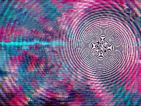 | [**colorful-moire**](colorful-moire.html) · [js](colorful-moire.js) The Glitch Prophet: Hash noise · Moire as Point: Archimedean Phantom Spiral · The interference creates radial spokes that appear to spin independently | WebGL2 / three.js |  | repo_script_js5_code |
| 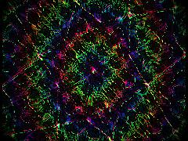 | [**dynamic-math**](dynamic-math.html) · [js](dynamic-math.js) HSB to RGB for the Lisa Frank / Acid Vibration palette fusion · Psychedelic Collage: Kaleidoscope / Mirror-Tile Pattern (psc.technique.kaleidoscope_pattern.v1) · The Strange Mechanism: Acoustic Cleavage | WebGL2 / three.js |  | repo_script_js5_code |
| 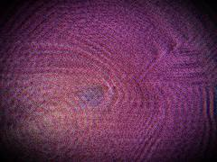 | [**dynamic-moire**](dynamic-moire.html) · [js](dynamic-moire.js) REPO 1: Chromatic RGB Moiré via CMYK Separation · High-frequency interference patterns driven by time and space · Cyan: Spiral Phantom counter-rotation | WebGL2 / three.js |  | repo_script_js5_code repo_script_js5_code |
| 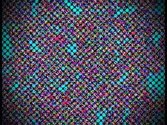 | [**dynamic-repo**](dynamic-repo.html) · [js](dynamic-repo.js) NOISE FIELDS: Compact Simplex 2D · VIBRATION: Chladni Plate Modal Analysis · Superimposing degenerate modes to find nodal lines | WebGL2 / three.js |  | repo_script_js5_code |
| 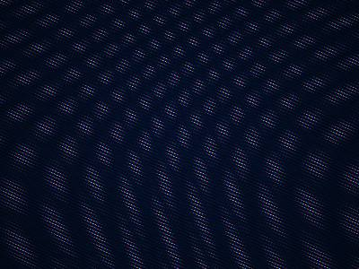 | [**led-moire**](led-moire.html) · [js](led-moire.js) Generates a continuous sine-wave based LED triad grid · Spatial phase shift for RGB subpixels (0, 120, 240 degrees) · Y-axis scanline gap | WebGL2 / three.js |  | repo_script_js5_code |
| 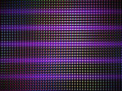 | [**led-pulse**](led-pulse.html) · [js](led-pulse.js) The core moiré interference generator · Using a soft dot grid to maximize 2D interference with the subpixel matrix · 1. THE HEARTBEAT (TEMPORAL MECHANISM) | WebGL2 / three.js |  | repo_script_js5_code repo_script_js5_code repo_script_js5_code |
| 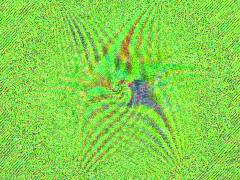 | [**moire**](moire.html) · [js](moire.js) Machine Hesitation: stuttering time progression · Read memory buffer · Holographic Boundary Warp (AdS Scaling) | WebGL2 / three.js |  | repo_script_js5_code |
| 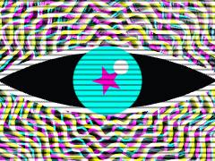 | [**moire-dna**](moire-dna.html) · [js](moire-dna.js) Temporal Feedback Moiré (Repo 1: Technique 06) + Cyberdelic Neon (Repo 2) · Void Black with alpha for feedback decay · Mouse interaction drives Anamorphic / Misregistration Moiré (Repo 1: Tech 10 / Repo 2) | Canvas 2D |  | repo_script_js5_code |
| 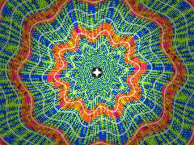 | [**moire-interference**](moire-interference.html) · [js](moire-interference.js) Psychedelic Pop &quot;Acid Vibration&quot; Palette · Curvilinear rhythm: Scalloped Flower / Eye shape generator · Halftone screen artifact (from print_artifacts) | WebGL2 / three.js |  | repo_script_js5_code |
| 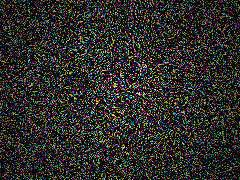 | [**moire-point**](moire-point.html) · [js](moire-point.js) GLSL 3.0 Feral Graffiti Moiré · Feral Noise Engine (Simplex 2D) · Fractional Brownian Motion for Spray/Drip Textures | WebGL2 / three.js |  | repo_script_js5_code |
| 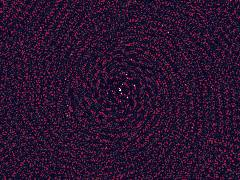 | [**moire-star**](moire-star.html) · [js](moire-star.js) Feral Design Brain: Anamorphic Quasicrystal Moiré with Structural Color Thin-Film Interference · COLOR FIELDS: IQ Cosine Palette (Neon Acid / Iridescent) · From merrypranxter/color_fields | WebGL2 / three.js |  | repo_script_js5_code |
| 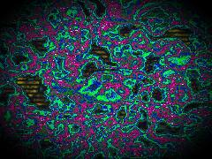 | [**neon-acid-void**](neon-acid-void.html) · [js](neon-acid-void.js) Fractal Brownian Motion · Cellular (Worley) F1/F2 · 1. Slow global drift (Geological/Mycelial growth) | WebGL2 / three.js |  | repo_script_js5_code repo_script_js5_code |
| 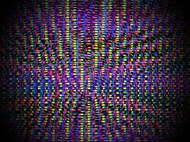 | [**neon-heartbeat**](neon-heartbeat.html) · [js](neon-heartbeat.js) Noise for feral tearing · Domain warp (Fungus/Liquid logic) · Pixel-perfect coordinates for the LED grid | WebGL2 / three.js |  | repo_script_js5_code |
| 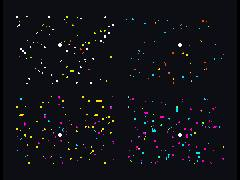 | [**neon-moire-stars**](neon-moire-stars.html) · [js](neon-moire-stars.js)  | WebGL2 / three.js |  | repo_script_js5_code |
| 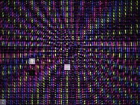 | [**neon-pulse**](neon-pulse.html) · [js](neon-pulse.js) Heartbeat pulse: thump-thump · Spatial distortion linked to the heartbeat · Chromatic moiré offsets | WebGL2 / three.js |  | repo_script_js5_code |
| 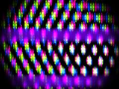 | [**neon-pulse-grid**](neon-pulse-grid.html) · [js](neon-pulse-grid.js) Generates a continuous sinusoidal wave grating · Heartbeat mechanism: double pump (lub-dub) · Spatial warping based on heartbeat to make the moiré &quot;breathe&quot; and roll | WebGL2 / three.js |  | repo_script_js5_code |
| 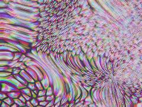 | [**neon_serpent_interference_20260625_142516**](neon_serpent_interference_20260625_142516.html) · [js](neon_serpent_interference_20260625_142516.js) Common GLSL functions · 1. Flow Shader (Schlieren + Advection) · Mouse interaction | WebGL2 / three.js |  | shader_files_2 shader_files_2 |
| 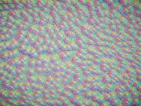 | [**neon_serpent_interference_20260625_143550**](neon_serpent_interference_20260625_143550.html) · [js](neon_serpent_interference_20260625_143550.js)  | WebGL2 / three.js |  | shader_files_2 |
| 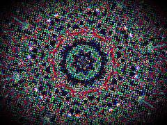 | [**repo-flow**](repo-flow.html) · [js](repo-flow.js) Animate crystal lattice · CHLADNI VIBRATION · KALEIDOSCOPE DISTORTION | WebGL2 / three.js |  | repo_script_js5_code |
| 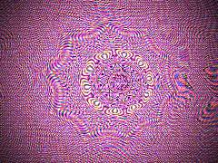 | [**structural-moire**](structural-moire.html) · [js](structural-moire.js) Procedural paper grain / xerox noise · Occult Mandala / Kaleidoscope Fold · Print Artifact: Halftone Dot Screen | WebGL2 / three.js |  | repo_script_js5_code |
| 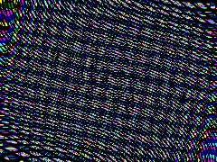 | [**subpixel-moire**](subpixel-moire.html) · [js](subpixel-moire.js) THE WEIRD CODE GUY: CHROMATIC CANNIBALISM &amp; SILICON NECROSIS · We do not just overlay grids. We extract the interferential cross-products. · The Hostile Substrate: A perfect RGB triad LED structure | WebGL2 / three.js |  | repo_script_js5_code |
| 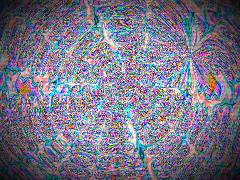 | [**vivid-repo-shader**](vivid-repo-shader.html) · [js](vivid-repo-shader.js) Setup Scene &amp; Camera · THE ALCHEMICAL SHADER · A chimera of Cymatics (Bessel functions), Moiré interference, Lace topology, | WebGL2 / three.js |  | repo_script_js5_code shader_files_2 |
