# 09 · Symmetry, kaleidoscopes & sacred geometry

**What's in here:** Dihedral folds, wallpaper/space groups, mandalas, Flower of Life, sigil glass.

**The idea in one breath:** Fold space like paper: mirror it N times around a point and anything you draw becomes a mandala. Group theory, but make it stained glass.

12 designs. Each is a pair: open the `.html` in any browser (self-contained, no server); the `.js` is the raw sketch source.

| | Design | Renderer | Notes | From |
|---|---|---|---|---|
| 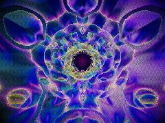 | [**math-dynamics**](math-dynamics.html) · [js](math-dynamics.js) REPO 4: Psychedelic Collage (Kaleidoscope &amp; Distortion) · Hexagonal mirror fold mapping to Crystalline P6/mmm Space Group · REPO 2: Vibration Physics (Chladni Modal Analysis) | WebGL2 / three.js |  | repo_script_js5_code |
| 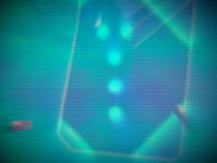 | [**prismatic-sigil-glass_20260623_221750**](prismatic-sigil-glass_20260623_221750.html) · [js](prismatic-sigil-glass_20260623_221750.js)  | WebGL2 / three.js |  | shader_files_2 |
| 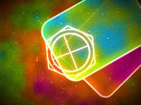 | [**prismatic-sigil-glass_20260624_001213**](prismatic-sigil-glass_20260624_001213.html) · [js](prismatic-sigil-glass_20260624_001213.js) Heat haze &amp; Schlieren flow background · Rich midtone texture · Drifting Glass Panes (Collage Fragments) | WebGL2 / three.js |  | shader_files_2 shader_files_2 |
| 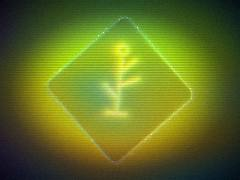 | [**prismatic-sigil-glass_20260624_005510**](prismatic-sigil-glass_20260624_005510.html) · [js](prismatic-sigil-glass_20260624_005510.js) Best for HDR/accumulation blending · Pass 1: Main Scene - Refraction, Schlieren, Sigils, Glass Panes · Cyan to Magenta | WebGL2 / three.js |  | shader_files_2 |
| 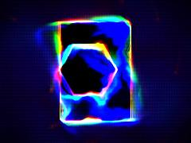 | [**prismatic-sigil-glass_20260624_011012**](prismatic-sigil-glass_20260624_011012.html) · [js](prismatic-sigil-glass_20260624_011012.js) Temporal Sampling with Pulfrich RGB split · Slow outward spiral · Scene Generation | WebGL2 / three.js |  | shader_files_2 |
| 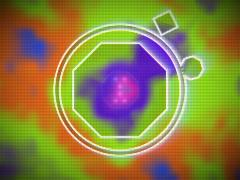 | [**prismatic_sigil_glass_20260623_232106**](prismatic_sigil_glass_20260623_232106.html) · [js](prismatic_sigil_glass_20260623_232106.js) Fast 3D Hash &amp; Noise for Schlieren Flow · Rich, midtone-heavy palette: Cyan, Magenta, Violet, Acid Green, Orange, Electric Blue · SDF Primitives | WebGL2 / three.js |  | shader_files_2 |
| 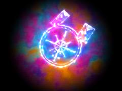 | [**prismatic_sigil_glass_20260624_004811**](prismatic_sigil_glass_20260624_004811.html) · [js](prismatic_sigil_glass_20260624_004811.js) 2D Rotation Matrix · Hash and Noise functions for fluid / schlieren · Signed Distance Functions | WebGL2 / three.js |  | shader_files_2 |
| 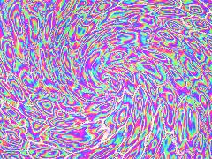 | [**sacred-geometry**](sacred-geometry.html) · [js](sacred-geometry.js) Biological/Fungal noise · Sacred Hex Grid (Flower of Life base) · Structural Color: Thin Film Interference (from Repo 2) | WebGL2 / three.js |  | repo_script_js5_code |
| 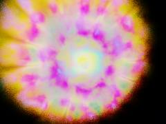 | [**tibetan-nebula_20260617_091030**](tibetan-nebula_20260617_091030.html) · [js](tibetan-nebula_20260617_091030.js) THE WEIRD CODE GUY: KIOSHI-ABSORBER-V1 + ALCHEMICAL SCRIPTURE MODULE · THEME: Tibetan Thangka Style Nebula Formation · MECHANISM: &quot;Divine Data Corruption&quot; x &quot;Volumetric Gas&quot;. | WebGL2 / three.js |  | shader_files_2 |
| 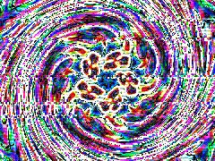 | [**wowwwwww_20260630_194327**](wowwwwww_20260630_194327.html) · [js](wowwwwww_20260630_194327.js) Bayer 4x4 matrix for Ditherpunk / Pixel Voxel texturing · Cellular structure / Reaction-Diffusion bloom base · Dihedral group folding (Kaleidoscope Engine) | WebGL2 / three.js |  | shader_files_2 shader_files_2 shader_files_2 |
| 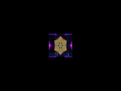 | [**wowwwwww_20260630_194813**](wowwwwww_20260630_194813.html) · [js](wowwwwww_20260630_194813.js)  | WebGL2 / three.js |  | shader_files_2 |
| 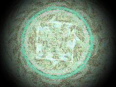 | [**wowwwwww_20260630_195539**](wowwwwww_20260630_195539.html) · [js](wowwwwww_20260630_195539.js) MATH &amp; FOLDING (Kaleidoscope, Non-Orientable Manifolds) · DITHERING &amp; TEXTURE (Ditherpunk, Pixel-Voxel) · CONTINUOUS CELLULAR AUTOMATA &amp; NOISE (Lenia, Speckle) | WebGL2 / three.js |  | shader_files_2 |
