# 10 · Raymarched 3D: SDFs & gyroids

**What's in here:** Signed-distance-field raymarching, gyroids & triply-periodic minimal surfaces, glass/caustic shading.

**The idea in one breath:** Shoot a ray per pixel and step forward by 'how far is the nearest surface?' until you hit something. Gyroids = infinite soap-film sponges.

27 designs. Each is a pair: open the `.html` in any browser (self-contained, no server); the `.js` is the raw sketch source.

| | Design | Renderer | Notes | From |
|---|---|---|---|---|
| 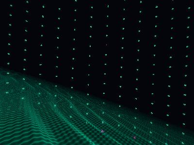 | [**biolum-terraces**](biolum-terraces.html) · [js](biolum-terraces.js) THE OCEAN / MATH (Diagonal Terrace SDF) · Emotional Gravity Lensing: space warping based on time · Diagonal rotation | WebGL2 / three.js |  | repo_script_js5_code |
|  | [**gyroid-chroma-engine_20260625_113410**](gyroid-chroma-engine_20260625_113410.html) · [js](gyroid-chroma-engine_20260625_113410.js)  | WebGL2 / three.js |  | shader_files_2 |
| 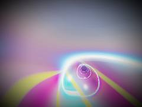 | [**gyroid_chroma_engine_20260625_114747**](gyroid_chroma_engine_20260625_114747.html) · [js](gyroid_chroma_engine_20260625_114747.js)  | WebGL2 / three.js |  | shader_files_2 shader_files_2 |
| 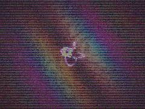 | [**neon-math-shader**](neon-math-shader.html) · [js](neon-math-shader.js) Tetragrammaton 4-fold Symmetry · The Ocean / Math (Substrate) · The Whirring (Central Rotors) | WebGL2 / three.js |  | repo_script_js5_code |
| 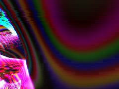 | [**prismatic-mycelium-gyroid_20260622_185227**](prismatic-mycelium-gyroid_20260622_185227.html) · [js](prismatic-mycelium-gyroid_20260622_185227.js) PASS 1: WFC Gyroid &amp; Mycelium Raymarcher · Scene SDF: WFC Gyroid Cathedral · WFC Logic: Cells flip and rotate rhythmically | WebGL2 / three.js |  | shader_files_2 shader_files_2 shader_files_2 shader_files_2 |
| 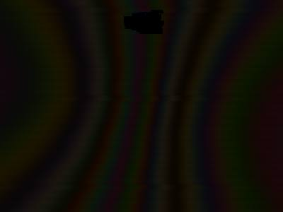 | [**prismatic-mycelium_20260622_183925**](prismatic-mycelium_20260622_183925.html) · [js](prismatic-mycelium_20260622_183925.js) WFC modular layout · Gyroid lattice with glass facets · Mix WFC and Gyroid to create growing/collapsing structure | WebGL2 / three.js |  | shader_files_2 shader_files_2 |
|  | [**prismatic-mycelium_20260622_191048**](prismatic-mycelium_20260622_191048.html) · [js](prismatic-mycelium_20260622_191048.js) Wave Function Collapse - Fake State Mutation · Gyroid Lattice · Mycelial Network through the WFC cells | WebGL2 / three.js |  | shader_files_2 |
| 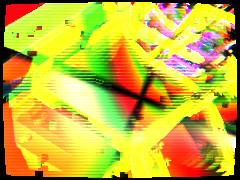 | [**prismatic-mycelium_20260623_132723**](prismatic-mycelium_20260623_132723.html) · [js](prismatic-mycelium_20260623_132723.js) Ping-pong FBOs for Temporal Datamoshing &amp; Persistence · PASS 1: The Cathedral (Raymarched Gyroid + WFC Tiles + Mycelium) · Gyroid Lattice | WebGL2 / three.js |  | shader_files_2 |
| 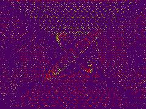 | [**prismatic-tape-oracle_20260625_162135**](prismatic-tape-oracle_20260625_162135.html) · [js](prismatic-tape-oracle_20260625_162135.js) FBO Setup for Ping-Ponging · 1. CELLULAR AUTOMATA SHADER (The Machine Mind) · Continuous CA rule for crystalline logic blooms | WebGL2 / three.js |  | shader_files_2 shader_files_2 |
| 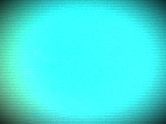 | [**prismatic_mycelial_gyroid_20260622_192120**](prismatic_mycelial_gyroid_20260622_192120.html) · [js](prismatic_mycelial_gyroid_20260622_192120.js) Glass Gyroid panels (WFC modular shards) · Mycelium network growing through the glass · Glass: Michel-Levy Birefringence | WebGL2 / three.js |  | shader_files_2 |
| 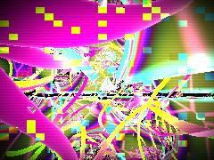 | [**prismatic_mycelium_20260622_191643**](prismatic_mycelium_20260622_191643.html) · [js](prismatic_mycelium_20260622_191643.js) Dave_Hoskins hash functions · Main SDF Mapping · WFC Cell logic (macro grid) | WebGL2 / three.js |  | shader_files_2 |
| 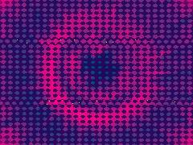 | [**prismatic_tape_oracle_20260618_194154**](prismatic_tape_oracle_20260618_194154.html) · [js](prismatic_tape_oracle_20260618_194154.js) 1. CELLULAR AUTOMATA PASS (The Machine Mind) · Continuous chaotic rule · 2. MAIN SCENE + DATAMOSH FEEDBACK PASS (Dream Physics &amp; Op-Art) | WebGL2 / three.js |  | shader_files_2 shader_files_2 |
| 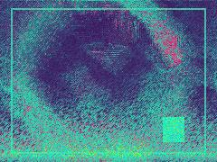 | [**prismatic_tape_oracle_20260618_195123**](prismatic_tape_oracle_20260618_195123.html) · [js](prismatic_tape_oracle_20260618_195123.js) RENDER TARGETS (Ping-Pong Buffers) · Required for CA and Datamosh precision · 1. CELLULAR AUTOMATA INTELLIGENCE (Lenia/Reaction-Diffusion Hybrid) | WebGL2 / three.js |  | shader_files_2 shader_files_2 |
| 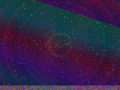 | [**prismatic_tape_oracle_20260618_200515**](prismatic_tape_oracle_20260618_200515.html) · [js](prismatic_tape_oracle_20260618_200515.js) 1. Cellular Automata (Dream Intelligence) · Reaction-diffusion with spatially varying rules · Spontaneous &quot;dream physics&quot; memory injection | WebGL2 / three.js |  | shader_files_2 shader_files_2 |
| 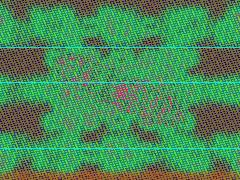 | [**prismatic_tape_oracle_20260618_202021**](prismatic_tape_oracle_20260618_202021.html) · [js](prismatic_tape_oracle_20260618_202021.js) COMMON GLSL CHUNKS · SIMULATION SHADER (Raymarch + CA + Datamosh + Dream Physics) · Palette for structural color / Bragg reflection | WebGL2 / three.js |  | shader_files_2 |
| 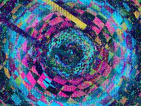 | [**prismatic_tape_oracle_20260619_204529**](prismatic_tape_oracle_20260619_204529.html) · [js](prismatic_tape_oracle_20260619_204529.js) OKLAB PERCEPTUAL COLOR CHEMISTRY · Absolute Color Rules: Saturated Shadows to Luminous Highlights · Peacock Green Shadow | WebGL2 / three.js |  | shader_files_2 shader_files_2 |
| 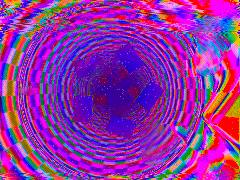 | [**prismatic_tape_oracle_20260619_205541**](prismatic_tape_oracle_20260619_205541.html) · [js](prismatic_tape_oracle_20260619_205541.js) CELLULAR AUTOMATA (Brian&#x27;s Brain Variant) · Continuous noise seeding to keep the organism alive · DREAM PHYSICS ARCHITECTURE &amp; DATAMOSH | WebGL2 / three.js |  | shader_files_2 shader_files_2 shader_files_2 |
| 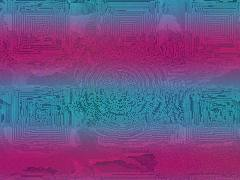 | [**prismatic_tape_oracle_20260619_211142**](prismatic_tape_oracle_20260619_211142.html) · [js](prismatic_tape_oracle_20260619_211142.js) Ping-Pong FBOs for Datamosh / Cellular Automata Memory · THE ORACLE ENGINE (BUFFER SHADER) · Handles Dream Physics, Op-Art, Cellular Automata, and Datamosh | WebGL2 / three.js |  | shader_files_2 shader_files_2 |
| 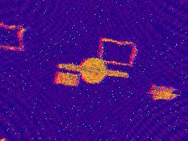 | [**prismatic_tape_oracle_20260619_211853**](prismatic_tape_oracle_20260619_211853.html) · [js](prismatic_tape_oracle_20260619_211853.js) PASS 1: Cellular Automata &quot;Mind&quot; (Lenia-lite + Fluid Advection) · 9-tap average for continuous cellular automata · Activation rule (Dream Logic) | WebGL2 / three.js |  | shader_files_2 shader_files_2 |
| 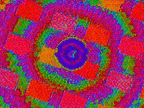 | [**prismatic_tape_oracle_20260619_212904**](prismatic_tape_oracle_20260619_212904.html) · [js](prismatic_tape_oracle_20260619_212904.js) CELLULAR AUTOMATA PASS (Gray-Scott Reaction-Diffusion) · MAIN SCENE PASS (Dream Physics, Op-Art, Early Internet) · Structural Color Iridescence | WebGL2 / three.js |  | shader_files_2 shader_files_2 shader_files_2 shader_files_2 |
| 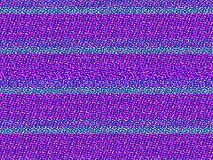 | [**prismatic_tape_oracle_20260619_214625**](prismatic_tape_oracle_20260619_214625.html) · [js](prismatic_tape_oracle_20260619_214625.js) 1. CELLULAR AUTOMATA (Dream Intelligence) · Infection / Seeding · 2. SCENE &amp; DATAMOSH (Dream Architecture &amp; Memory) | WebGL2 / three.js |  | shader_files_2 shader_files_2 shader_files_2 shader_files_2 shader_files_2 |
| 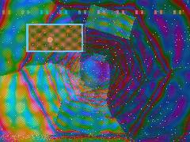 | [**prismatic_tape_oracle_20260619_215756**](prismatic_tape_oracle_20260619_215756.html) · [js](prismatic_tape_oracle_20260619_215756.js) COLOR SYSTEMS (OKLab) · STRICT DREAM PHYSICS PALETTE · i = intensity (0.0 to 1.0) | WebGL2 / three.js |  | shader_files_2 shader_files_2 |
| 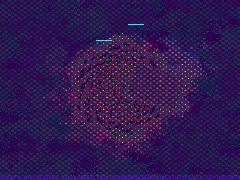 | [**prismatic_tape_oracle_20260619_221345**](prismatic_tape_oracle_20260619_221345.html) · [js](prismatic_tape_oracle_20260619_221345.js) Acquire context and dimensions · Ping-pong FBOs for Datamosh &amp; Cellular Automata · BUFFER A: THE ENGINE | WebGL2 / three.js |  | shader_files_2 shader_files_2 |
| 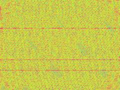 | [**prismatic_tape_oracle_20260625_161140**](prismatic_tape_oracle_20260625_161140.html) · [js](prismatic_tape_oracle_20260625_161140.js) FBO Setup for Ping-Pong and Passes · Chunky pixels for early internet vibe · Better precision for feedback | WebGL2 / three.js |  | shader_files_2 |
| 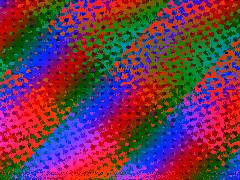 | [**prismatic_tape_oracle_20260625_161657**](prismatic_tape_oracle_20260625_161657.html) · [js](prismatic_tape_oracle_20260625_161657.js) Ping-Pong FBOs for Cellular Automata &amp; Datamosh Memory · Using HalfFloatType for precision in feedback loops without massive overhead · SHARED SHADER CHUNKS | WebGL2 / three.js |  | shader_files_2 |
| 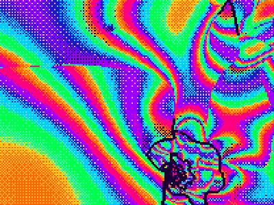 | [**repo-dynamic**](repo-dynamic.html) · [js](repo-dynamic.js) Crucial for pixel art pipelines · Pass 1: SDF Raymarcher (Reaction-Diffusion Gyroid + Structural Color) · Approximating Gray-Scott / Turing patterns via nested Gyroids | WebGL2 / three.js |  | repo_script_js5_code |
| 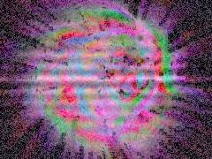 | [**repo-shader-flux**](repo-shader-flux.html) · [js](repo-shader-flux.js) BASE PASS: RAYMARCHED CYMATIC GYROID · COLOR SYSTEMS: OKLCh to sRGB conversion for perceptually uniform neon colors · THE-LISTS &amp; CYMATICS &amp; LACE: Spatial mapping | WebGL2 / three.js |  | repo_script_js5_code |
