# 11 · Hyperbolic, non-Euclidean & higher-dimensional

**What's in here:** Poincaré disk {7,3} tilings, Möbius transforms, Schottky groups, 4D/11D projections, G2 holonomy.

**The idea in one breath:** Geometry where parallel lines diverge and space has more room than it should—Escher's Circle Limit. Plus shadows of shapes from 4+ dimensions.

23 designs. Each is a pair: open the `.html` in any browser (self-contained, no server); the `.js` is the raw sketch source.

| | Design | Renderer | Notes | From |
|---|---|---|---|---|
| 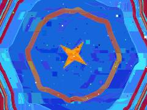 | [**11d-time-crystal**](11d-time-crystal.html) · [js](11d-time-crystal.js) REPO 3 &amp; 5: Entropy with Intention / Paradox Engines · Breaking temporal symmetry to create a &quot;Time Crystal&quot; · The flow of time stutters, reverses slightly, and jumps | Canvas 2D |  | repo_script_js5_code |
| 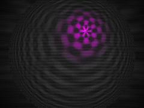 | [**crt-poincare**](crt-poincare.html) · [js](crt-poincare.js) Complex Arithmetic · Möbius Transform (Translate p to origin) · Hyperbolic Distance (safe atanh) | WebGL2 / three.js |  | repo_script_js5_code |
| 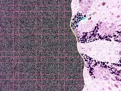 | [**dmt-trip_20260816_210846**](dmt-trip_20260816_210846.html) · [js](dmt-trip_20260816_210846.js) THE PALACE UI (KIFS Cathedral) · Forward movement (Tunnel Vortex transit) · Infinite repetition (Akashic Grid) | WebGL2 / three.js |  | shaderfiles3 |
| 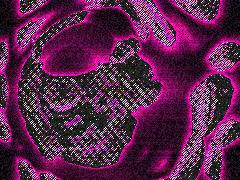 | [**dynamic-repo-art**](dynamic-repo-art.html) · [js](dynamic-repo-art.js) Photocopy noise / Precursor distribution · 4D / AdS Rotation · Entanglement geometry: Ryu-Takayanagi minimal surface bridges | WebGL2 / three.js |  | repo_script_js5_code |
| 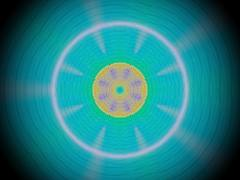 | [**emerald_incal_20260630_145755**](emerald_incal_20260630_145755.html) · [js](emerald_incal_20260630_145755.js) INITIALIZATION &amp; BOILERPLATE · Ping-pong render targets for temporal desync &amp; feedback · SHADER: SIMULATION (THE RITUAL ENGINE) | WebGL2 / three.js |  | shader_files_2 |
| 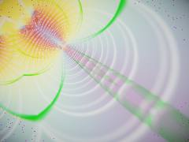 | [**emerald_incal_20260630_192656**](emerald_incal_20260630_192656.html) · [js](emerald_incal_20260630_192656.js) Retinotopic Kaleidoscope · Log-polar conformal map · Forward plunge into the throat | WebGL2 / three.js |  | shader_files_2 shader_files_2 |
| 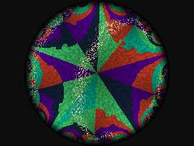 | [**fabric-damage**](fabric-damage.html) · [js](fabric-damage.js) {5,4} Tiling Constants · Center of inversion circle: c = cos(PI/4) / sin(PI/5) = 0.707106 / 0.587785 = 1.20299 · Radius: r = sqrt(c^2 - 1) = 0.66874 | WebGL2 / three.js |  | repo_script_js5_code |
| 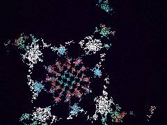 | [**fractal_crochet**](fractal_crochet.html) · [js](fractal_crochet.js) 2D Rotation Matrix · Psychedelic Neon Acid / Oklab inspired Cosine Palette · Mathematical Crochet &amp; Fractal Lace SDF | WebGL2 / three.js |  | repo_script_js5_code |
| 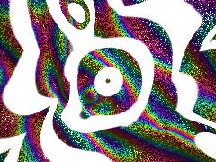 | [**g2-holonomy**](g2-holonomy.html) · [js](g2-holonomy.js) Electric Coral · Acid Green / Neon Lemon · Cyan / Turquoise | WebGL2 / three.js |  | repo_script_js5_code |
| 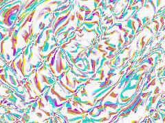 | [**g2-membrane**](g2-membrane.html) · [js](g2-membrane.js) ALCHEMICAL FOUNDATION · Fast hash for structural noise · Cellular noise for photonic crystal structures &amp; tissue bounds | WebGL2 / three.js |  | repo_script_js5_code |
| 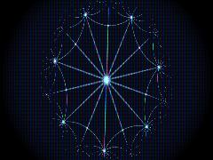 | [**hyperbolic-led**](hyperbolic-led.html) · [js](hyperbolic-led.js) {7,3} Hyperbolic Tiling Constants (Poincare Disk) · Subtle CRT Barrel Distortion · Map to Poincare disk space | WebGL2 / three.js |  | repo_script_js5_code |
| 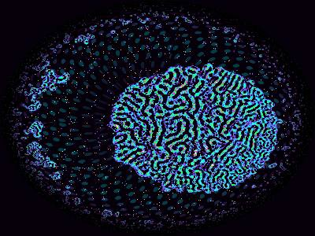 | [**hyperbolic-reef**](hyperbolic-reef.html) · [js](hyperbolic-reef.js) Ping-pong buffers for continuous CA state · FERAL CA SHADER: Lenia-like continuous automata in a Möbius-warped Poincaré disk · Complex math for hyperbolic geometry | WebGL2 / three.js |  | repo_script_js5_code |
| 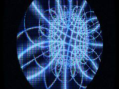 | [**hyperbolic-subpixel**](hyperbolic-subpixel.html) · [js](hyperbolic-subpixel.js) Complex math for Möbius transformations · CRT Geometry Distortion · Schottky Group Inversion Fractal for Hyperbolic Tessellation | WebGL2 / three.js |  | repo_script_js5_code |
| 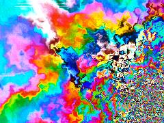 | [**monday_20260615_114132**](monday_20260615_114132.html) · [js](monday_20260615_114132.js) MATHEMATICAL SUBSTRATE (Domain 16 / Higher Math) · COLOR ALCHEMY (OKLab / Perceptual Space) · FERAL NOISE (Outsider Art / Glitch Prophet) | WebGL2 / three.js |  | shader_files_2 shader_files_2 |
| 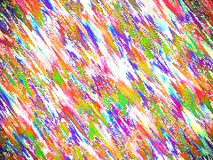 | [**monday_20260615_114606**](monday_20260615_114606.html) · [js](monday_20260615_114606.js) Outsider Art / Feral Noise Mechanics · Color Systems (OKLab) · Mathematical Masterpiece (Quasicrystal Lattices) | WebGL2 / three.js |  | shader_files_2 |
| 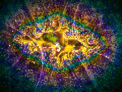 | [**monday_20260615_115555**](monday_20260615_115555.html) · [js](monday_20260615_115555.js) Color Systems (OKLab) · Structural Color · Anisotropic Rainblown Wind (Domain 15) | WebGL2 / three.js |  | shader_files_2 shader_files_2 shader_files_2 shader_files_2 |
| 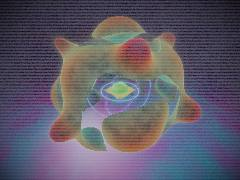 | [**neon-topology**](neon-topology.html) · [js](neon-topology.js) PALETTES (From Merry&#x27;s Visual Bible &amp; Retrofuturism) · Y2K Techno-Pop Neon · MATH &amp; NOISE UTILS | WebGL2 / three.js |  | repo_script_js5_code |
| 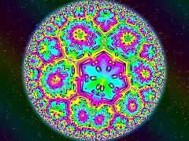 | [**non-euclidean**](non-euclidean.html) · [js](non-euclidean.js) Complex Math &amp; Mobius Transformations · Lisa Frank Overclocked Neon Palette · Hot Pink to Purple | WebGL2 / three.js |  | repo_script_js5_code |
| 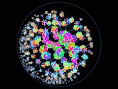 | [**noneuc-crystal**](noneuc-crystal.html) · [js](noneuc-crystal.js)  | Canvas 2D |  | repo_script_js5_code |
| 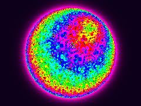 | [**noneucl_tess**](noneucl_tess.html) · [js](noneucl_tess.js) Complex arithmetic · Möbius transformation: translates point &#x27;a&#x27; to the origin · Fold into the fundamental domain of the {7, 3} hyperbolic tiling | WebGL2 / three.js |  | repo_script_js5_code |
| 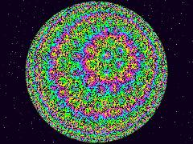 | [**noneuclid**](noneuclid.html) · [js](noneuclid.js) Hyperbolic {7,3} Tiling Math (Poincaré Disk) · We compute the fundamental domain reflection circle geodesics on the CPU. · Lisa Frank Hyper-Vibrant Neon Palette | WebGL2 / three.js |  | repo_script_js5_code |
| 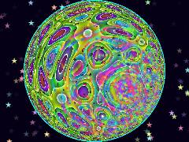 | [**noneuclidean-art**](noneuclidean-art.html) · [js](noneuclidean-art.js) Math structures for 5-fold Penrose/Lisa Frank Quasicrystal · Hyper-saturated Lisa Frank palette · Loop back to Pink | Canvas 2D |  | repo_script_js5_code |
| 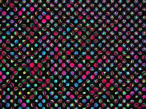 | [**repo-art**](repo-art.html) · [js](repo-art.js)  | WebGL2 / three.js |  | repo_script_js5_code |
