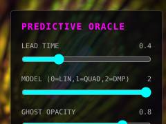
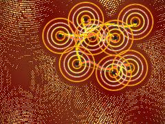
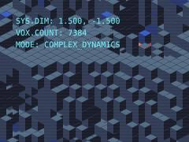
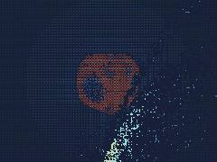
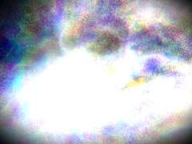
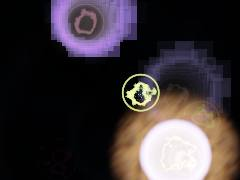
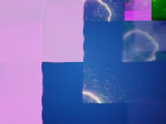
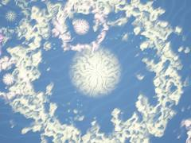
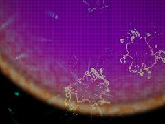
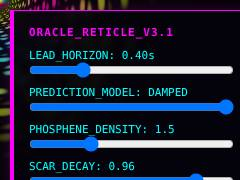

# 12 · Chaos, attractors & time dynamics

**What's in here:** Clifford / de Jong / Lorenz attractors, retrocausal & desync loops, predictive temporal feedback.

**The idea in one breath:** Deterministic systems so sensitive they look random, orbiting a 'strange attractor'. Also: pieces that play tricks with time (effects before causes).

12 designs. Each is a pair: open the `.html` in any browser (self-contained, no server); the `.js` is the raw sketch source.

| | Design | Renderer | Notes | From |
|---|---|---|---|---|
|  | [**BEST_SHADER_EVER_20260704_205826**](BEST_SHADER_EVER_20260704_205826.html) · [js](BEST_SHADER_EVER_20260704_205826.js) Ping-pong buffers for temporal feedback · High-saturation neon palette · Push saturation extremely high | WebGL2 / three.js |  | shaderfiles3 shaderfiles3 shaderfiles3 |
|  | [**dreamtime_20260616_111541**](dreamtime_20260616_111541.html) · [js](dreamtime_20260616_111541.js) Hash function for pseudo-random deterministic placement · SDF for line segments (Dreaming Tracks) · Peter de Jong Attractor displacement (Op Art / Dream Physics affective field) | WebGL2 / three.js |  | shader_files_2 |
|  | [**git-blend**](git-blend.html) · [js](git-blend.js) [FERAL DESIGN-BRAIN: ENGAGED] · [MECHANISM]: Iterative Dither-Collapse. · A chaotic 2.5D strange attractor (Clifford variant) is forced into a rigid, | Canvas 2D |  | repo_script_js5_code |
|  | [**git-manifold**](git-manifold.html) · [js](git-manifold.js) INITIALIZATION · SCENE 1: Strange Attractor Particles (Foreground) · Apollo sky_blue base | WebGL2 / three.js |  | repo_script_js5_code |
|  | [**github-art**](github-art.html) · [js](github-art.js) Seed initial positions · Update Pass (Strange Attractor + Fluid Dynamics + Tessellation) · Domain Warping via p6m Tessellation Fold | WebGL2 / three.js |  | repo_script_js5_code |
|  | [**retrocausal-fossils_20260705_100253**](retrocausal-fossils_20260705_100253.html) · [js](retrocausal-fossils_20260705_100253.js)  | WebGL2 / three.js |  | shaderfiles3 shaderfiles3 |
|  | [**retrocausal_fossils_20260705_124459**](retrocausal_fossils_20260705_124459.html) · [js](retrocausal_fossils_20260705_124459.js) Fallback to UnsignedByteType if HalfFloat is not supported · Hashing &amp; Noise · Event Generator | WebGL2 / three.js |  | shaderfiles3 shaderfiles3 |
|  | [**retrograde-fossil-blasts_20260705_095214**](retrograde-fossil-blasts_20260705_095214.html) · [js](retrograde-fossil-blasts_20260705_095214.js) Electric blue void background · Wrap time for seamless 10-second loop · 1. FOSSIL SCAR (Echo-First) | WebGL2 / three.js |  | shaderfiles3 shaderfiles3 |
|  | [**retrograde_fossils_20260707_062827**](retrograde_fossils_20260707_062827.html) · [js](retrograde_fossils_20260707_062827.js) Afterimage painter: complementary burn-in · Base decay creates trails without smearing static objects into oblivion · Deterministic event parameters | WebGL2 / three.js |  | shaderfiles3 |
|  | [**temporal_desync_oracle_20260704_211857**](temporal_desync_oracle_20260704_211857.html) · [js](temporal_desync_oracle_20260704_211857.js) Predictive Lead Math (temporal_desync) · Retinotopic Geometry (phosphene_field) · Color Palette (color_space_warp max saturation) | WebGL2 / three.js |  | shaderfiles3 |
|  | [**temporal_fossils_20260705_094731**](temporal_fossils_20260705_094731.html) · [js](temporal_fossils_20260705_094731.js) Scars that never explode · Time relative to blast, wrapped to [-5, 5] for seamless loop · Floating Point Dementia: coordinate precision tearing at the moment of the blast | WebGL2 / three.js |  | shaderfiles3 shaderfiles3 |
|  | [**temporal_oracle_20260705_092955**](temporal_oracle_20260705_092955.html) · [js](temporal_oracle_20260705_092955.js) Feral UI Injection · Ping-pong buffers for temporal scars · Damped model (k=3.0) | WebGL2 / three.js |  | shaderfiles3 shaderfiles3 shaderfiles3 |
