# 13 · Optics, spectra & color science

**What's in here:** Thin-film iridescence, birefringence, dispersion/prisms, CIE spectral color, OKLab/OKLCh color math.

**The idea in one breath:** Physics of light: soap-bubble rainbows (thin-film interference), prisms splitting wavelengths, and perceptual color spaces that keep neon from going muddy.

28 designs. Each is a pair: open the `.html` in any browser (self-contained, no server); the `.js` is the raw sketch source.

| | Design | Renderer | Notes | From |
|---|---|---|---|---|
| 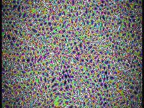 | [**acid_candy**](acid_candy.html) · [js](acid_candy.js) Feral Hash functions · Fractional Brownian Motion (Enzymatic Flow) · Diatom Silica Hex Pores | WebGL2 / three.js |  | repo_script_js5_code |
| 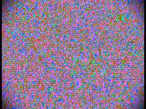 | [**acidic-candy**](acidic-candy.html) · [js](acidic-candy.js) ALCHEMICAL NOISE ENGINE · PERCEPTUAL COLOR SPACE (OKLCh) · sRGB Gamma encoding | WebGL2 / three.js |  | repo_script_js5_code |
| 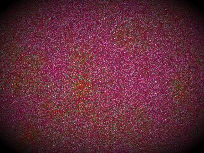 | [**beautiful_20260617_150455**](beautiful_20260617_150455.html) · [js](beautiful_20260617_150455.js) OKLab Color System · Memphis Patterns · Rainblown domain warp | WebGL2 / three.js |  | shader_files_2 shader_files_2 shader_files_2 |
| 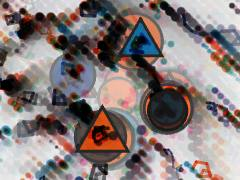 | [**beautiful_20260617_151458**](beautiful_20260617_151458.html) · [js](beautiful_20260617_151458.js)  | Canvas 2D |  | shader_files_2 |
| 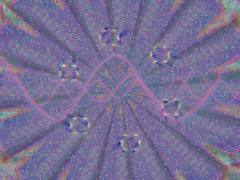 | [**chimeric-prism-cathedral_20260624_203708**](chimeric-prism-cathedral_20260624_203708.html) · [js](chimeric-prism-cathedral_20260624_203708.js) PASS 1: CATHEDRAL (The Core Optical Engine) · OKLab conversions for perceptual gradients · Mouse Gravity Warp | WebGL2 / three.js |  | shader_files_2 |
| 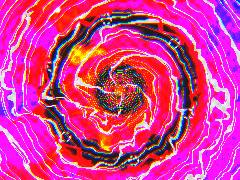 | [**chimeric-prism-cathedral_20260624_203924**](chimeric-prism-cathedral_20260624_203924.html) · [js](chimeric-prism-cathedral_20260624_203924.js) State &amp; Params · FBO Setup for ping-pong fatigue (impossible colors) and post-processing · MAIN CATHEDRAL SHADER | WebGL2 / three.js |  | shader_files_2 shader_files_2 |
| 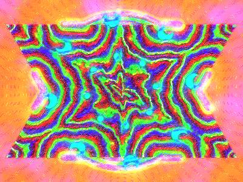 | [**chimeric-prism-cathedral_20260624_204630**](chimeric-prism-cathedral_20260624_204630.html) · [js](chimeric-prism-cathedral_20260624_204630.js) Ping-pong buffers for optical memory / impossible color fatigue · Float for HDR/fatigue math · MAIN SHADER (Cathedral, Plasma, Birefringence, Glass Patterns) | WebGL2 / three.js |  | shader_files_2 shader_files_2 |
| 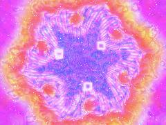 | [**chimeric_prism_cathedral_20260624_191116**](chimeric_prism_cathedral_20260624_191116.html) · [js](chimeric_prism_cathedral_20260624_191116.js) Palette shifts · MAIN CATHEDRAL GEOMETRY · Mouse interaction: Prism Lens Warp | WebGL2 / three.js |  | shader_files_2 shader_files_2 |
| 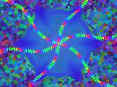 | [**chimeric_prism_cathedral_20260624_193608**](chimeric_prism_cathedral_20260624_193608.html) · [js](chimeric_prism_cathedral_20260624_193608.js) Cleanup previous instance if it exists to support hot-reloading · Ping-pong render targets for state/accumulation (Impossible Colors &amp; Plasma Trails) · State Shader: Handles mouse interactions, fatigue accumulation, and plasma trails | WebGL2 / three.js |  | shader_files_2 shader_files_2 |
| 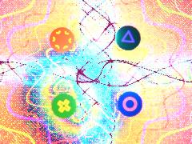 | [**chimeric_prism_cathedral_20260624_194054**](chimeric_prism_cathedral_20260624_194054.html) · [js](chimeric_prism_cathedral_20260624_194054.js)  | WebGL2 / three.js |  | shader_files_2 shader_files_2 |
| 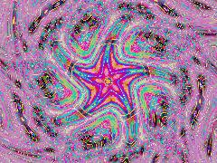 | [**chroma-soup_20260630_193926**](chroma-soup_20260630_193926.html) · [js](chroma-soup_20260630_193926.js) [SPECTRAL COLOR] Wyman Multi-Lobe Fit (CIE 1931) · [ACOUSTIC IMPEDANCE TESSELLATION] Voronoi Tissue Map · [KALEIDOSCOPE ENGINE] Dihedral Folding | WebGL2 / three.js |  | shader_files_2 shader_files_2 |
| 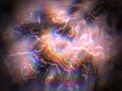 | [**chroma-soup_20260704_194823**](chroma-soup_20260704_194823.html) · [js](chroma-soup_20260704_194823.js) REPO: spectral_color &amp; chromostereopsis · Wyman, Sloan &amp; Shirley 2013 multi-lobe CMF fit · Acid gamma boost | WebGL2 / three.js |  | shaderfiles3 |
| 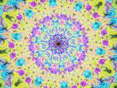 | [**chromasoup_20260701_223543**](chromasoup_20260701_223543.html) · [js](chromasoup_20260701_223543.js) Maximalist Candy-Acid Hyperpop Palette Sequence · White-hot highlights (Glitchcore spark) · 1. Glitchcore / Damage Aesthetics: Macroblock tearing | WebGL2 / three.js |  | shader_files_2 |
| 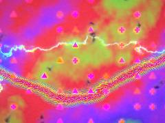 | [**chromatic-reef-surge_20260624_211707**](chromatic-reef-surge_20260624_211707.html) · [js](chromatic-reef-surge_20260624_211707.js) State &amp; Initialization · Keyboard Interaction · pulse reveals hidden patterns | WebGL2 / three.js |  | shader_files_2 |
| 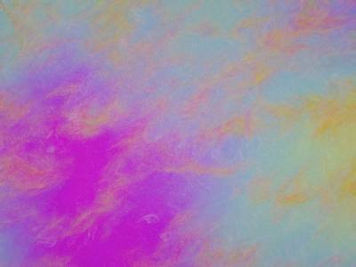 | [**chromatic_reef_surge_20260624_215107**](chromatic_reef_surge_20260624_215107.html) · [js](chromatic_reef_surge_20260624_215107.js) Ping-pong buffers for fluid feedback and optical persistence · MAIN REEF SHADER (Pass 1) · Palettes (No pure black/white) | WebGL2 / three.js |  | shader_files_2 shader_files_2 shader_files_2 shader_files_2 |
| 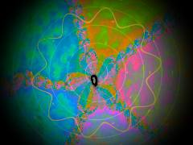 | [**holyshitballs_20260614_184614**](holyshitballs_20260614_184614.html) · [js](holyshitballs_20260614_184614.js) Feral Math &amp; Noise · Complex Dynamics · Structural Color (Thin Film Iridescence) | WebGL2 / three.js |  | shader_files_2 shader_files_2 |
| 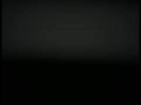 | [**mandelbrot-candy-prism**](mandelbrot-candy-prism.html) · [js](mandelbrot-candy-prism.js) Time integration · Deep dive logic (auto-pilot unless user interacts) · Auto dive into the Seahorse Valley / Deep Minibrot | WebGL2 / three.js |  | repo_script_js5_code |
| 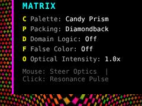 | [**prismatic_scale_matrix_20260625_145149**](prismatic_scale_matrix_20260625_145149.html) · [js](prismatic_scale_matrix_20260625_145149.js) Inject CSS for the UI · Create UI overlay · OKLCh to sRGB conversion for vivid, perceptually uniform colors | Canvas 2D |  | shader_files_2 |
| 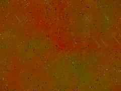 | [**rainblown-geometry_20260617_143331**](rainblown-geometry_20260617_143331.html) · [js](rainblown-geometry_20260617_143331.js) FERAL HASH &amp; NOISE (Mycelial streaming / Wet engine) · Divergence-free curl noise for &quot;rainblown&quot; advection · COMPLEX MATH (Newton Fractal Core) | WebGL2 / three.js |  | shader_files_2 shader_files_2 |
| 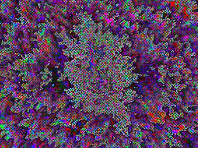 | [**rainblown-math**](rainblown-math.html) · [js](rainblown-math.js) ALCHEMICAL MATH: PRNG &amp; NOISE · DIVERGENCE-FREE CURL NOISE (Rainblown Shear) · COLOR SYSTEMS: OKLAB PERCEPTUAL SPACE | WebGL2 / three.js |  | repo_script_js5_code |
| 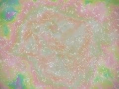 | [**rainblown-rainbow**](rainblown-rainbow.html) · [js](rainblown-rainbow.js) The Feral Design-Brain Shader: · Blending Structural Color (Thin-Film), Kirlian Discharge (L-Infinity Sparks), · and Domain Warped Fluid Dynamics (Rainblown). | WebGL2 / three.js |  | repo_script_js5_code |
| 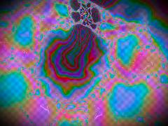 | [**rainblown_math**](rainblown_math.html) · [js](rainblown_math.js) Complex Arithmetic (Mobius Transforms) · Perceptual Color Space (OKLCh -&gt; OKLab -&gt; Linear sRGB -&gt; sRGB) · Procedural Noise (The Wind &amp; The Rain) | WebGL2 / three.js |  | repo_script_js5_code |
| 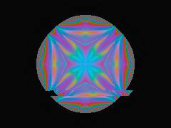 | [**rainbow-fractal**](rainbow-fractal.html) · [js](rainbow-fractal.js) OKLCh to sRGB (Perceptual Color Space) · Psychedelic Collage: The Tetragrammaton (4-fold symmetry fold) · Structural Color: Thin Film Interference | WebGL2 / three.js |  | repo_script_js5_code |
| 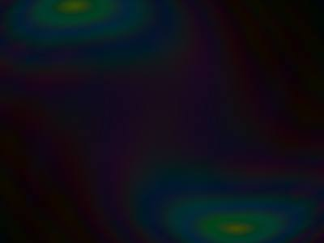 | [**rainbow_fractal**](rainbow_fractal.html) · [js](rainbow_fractal.js) [COLOR_SYSTEMS] OKLab to sRGB Conversion · Perceptually uniform color space interpolation · [COLOR_FIELDS] Spectral Rainbow via OKLCh | WebGL2 / three.js |  | repo_script_js5_code |
| 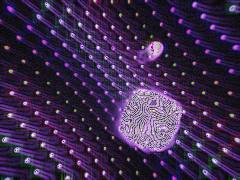 | [**spectral_desync_20260630_115002**](spectral_desync_20260630_115002.html) · [js](spectral_desync_20260630_115002.js) PASS 1: Raymarching, Dispersion, Diffraction, Float Dementia, Afterimage Accumulation · Impossible Prism Engine (Faceted + Liquid) · Simultaneous Contrast Nodes (Floating Traps) | WebGL2 / three.js |  | shader_files_2 shader_files_2 |
| 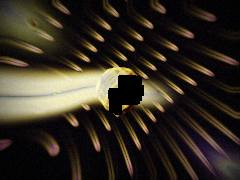 | [**spectrum_happened_20260630_113727**](spectrum_happened_20260630_113727.html) · [js](spectrum_happened_20260630_113727.js) Floating Point Dementia (Precision Loss at edges) · Color Space Morphing (Coordinate Twisting) · Semi-liquid facets | WebGL2 / three.js |  | shader_files_2 |
| 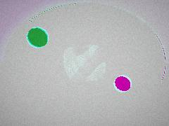 | [**spectrum_happened_20260630_114056**](spectrum_happened_20260630_114056.html) · [js](spectrum_happened_20260630_114056.js) Color-space morphing (Coordinate warping) · Main Prism Engine · Semi-liquid gyroid subtraction | WebGL2 / three.js |  | shader_files_2 |
| 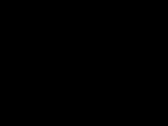 | [**THISWEIRDGREENONEHERE_20260630_144045**](THISWEIRDGREENONEHERE_20260630_144045.html) · [js](THISWEIRDGREENONEHERE_20260630_144045.js) HDR for bloom and accumulation · Saturated candy-acid spectrum · Boost contrast/saturation | WebGL2 / three.js |  | shader_files_2 |
