# 14 · Visual perception: stereograms, phosphenes & illusions

**What's in here:** SIRDS/autostereograms, wiggle stereo, chromadepth, phosphenes & retinotopic log-polar maps, Kanizsa illusions.

**The idea in one breath:** Art that hacks the visual system: hidden 3D you cross your eyes for, the shapes you see with eyes closed (mapped the way V1 maps them), illusory contours.

23 designs. Each is a pair: open the `.html` in any browser (self-contained, no server); the `.js` is the raw sketch source.

| | Design | Renderer | Notes | From |
|---|---|---|---|---|
| 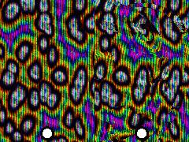 | [**birefringent-stereogram_20260622_104404**](birefringent-stereogram_20260622_104404.html) · [js](birefringent-stereogram_20260622_104404.js) Pass 1: Depth Map Generator (The Hidden Impossible Machine) · Rotate the entire spatial manifold slowly · Central birefringent crystal | WebGL2 / three.js |  | shader_files_2 |
| 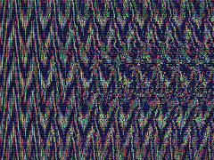 | [**birefringent-stereogram_20260622_105430**](birefringent-stereogram_20260622_105430.html) · [js](birefringent-stereogram_20260622_105430.js) PASS 1: THE ABYSSAL DEPTH MAP (Lithogenesis + Gyroid Labyrinths) · Descent into the machine · Machine hesitation / Glitch Prophet | WebGL2 / three.js |  | shader_files_2 |
| 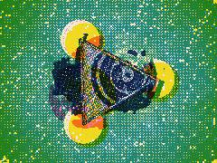 | [**chromadepth_riso_20260623_115743**](chromadepth_riso_20260623_115743.html) · [js](chromadepth_riso_20260623_115743.js) Kanizsa Pac-Man cutouts · Pulfrich/Chromadepth rings (lateral offsets mapped to depth) · Structural color thickness / Thin-film interference | WebGL2 / three.js |  | shader_files_2 |
| 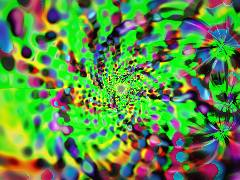 | [**gorgeous_20260705_163643**](gorgeous_20260705_163643.html) · [js](gorgeous_20260705_163643.js) Complex arithmetic · Noise &amp; Hashing · Motion: foveal breathing &amp; tremor | WebGL2 / three.js |  | shaderfiles3 shaderfiles3 |
| 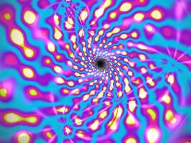 | [**gorgeous_20260705_164151**](gorgeous_20260705_164151.html) · [js](gorgeous_20260705_164151.js)  | WebGL2 / three.js |  | shaderfiles3 shaderfiles3 shaderfiles3 |
| 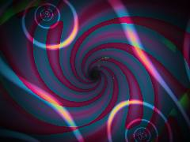 | [**jewel_phosphene_20260629_194920**](jewel_phosphene_20260629_194920.html) · [js](jewel_phosphene_20260629_194920.js) Render Targets for Ping-Pong FBO and Paint Pass · Complex Math (domain_coloring) · Chromostereopsis + Spectral mapping | WebGL2 / three.js |  | shader_files_2 |
| 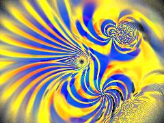 | [**jeweled_phosphenes_20260629_200614**](jeweled_phosphenes_20260629_200614.html) · [js](jeweled_phosphenes_20260629_200614.js)  | WebGL2 / three.js |  | shader_files_2 |
| 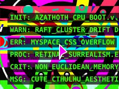 | [**lovecraft-mythos**](lovecraft-mythos.html) · [js](lovecraft-mythos.js) The &quot;Chaos Engineering&quot; panic state · Palettes extracted from repository clash · Psychedelic Pop meets Terminal Green meets Op-Art High Contrast | Canvas 2D | ⚠️ throws occasional errors | repo_script_js5_code |
| 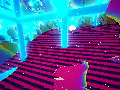 | [**neon-wiggle-stereo_20260622_182025**](neon-wiggle-stereo_20260622_182025.html) · [js](neon-wiggle-stereo_20260622_182025.js) WIGGLE STEREOSCOPY X VHS X TPMS X WFC · A maximalist, depth-driven raymarched scene synthesizing multiple repo genomes. · Wiggle stereoscopy is implemented natively in the raymarching camera using an off-axis projection model. | WebGL2 / three.js |  | shader_files_2 shader_files_2 shader_files_2 |
| 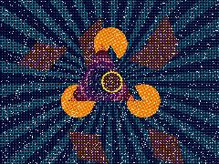 | [**perceptual_riso_illusion_20260623_115347**](perceptual_riso_illusion_20260623_115347.html) · [js](perceptual_riso_illusion_20260623_115347.js) Structural Color · Pulfrich lateral offsets mapping to Chromadepth · Background Sunburst (Simultaneous Contrast + Cool Colors Receding) | WebGL2 / three.js |  | shader_files_2 |
| 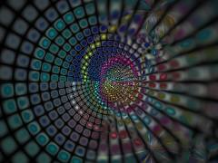 | [**phosphene_field_20260629_195841**](phosphene_field_20260629_195841.html) · [js](phosphene_field_20260629_195841.js) Luxurious foveal breathing &amp; tremor · Floating Point Dementia cracks at extreme edges or intense pulses · Domain Coloring: rational function evaluation | WebGL2 / three.js |  | shader_files_2 shader_files_2 |
| 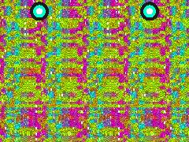 | [**psychedelic-autostereogram_20260620_193209**](psychedelic-autostereogram_20260620_193209.html) · [js](psychedelic-autostereogram_20260620_193209.js) Impossible Torus Knot / Alien Object · Orbiting gyroid-membrane satellites · Smooth background terrain (depth buffer needs smooth low-freq backdrops) | WebGL2 / three.js |  | shader_files_2 |
| 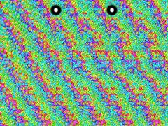 | [**psychedelic-autostereogram_20260621_213627**](psychedelic-autostereogram_20260621_213627.html) · [js](psychedelic-autostereogram_20260621_213627.js)  | WebGL2 / three.js |  | shader_files_2 shader_files_2 |
| 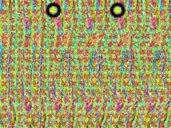 | [**psychedelic-sirds_20260620_184434**](psychedelic-sirds_20260620_184434.html) · [js](psychedelic-sirds_20260620_184434.js) Depth Target (NearestFilter prevents interpolated ghosting at sharp depth edges) · Pass 1: Depth Map (SDF Raymarching) · Alien Torus-Knot / Klein-bottle hybrid + Gyroid + Terrain | WebGL2 / three.js |  | shader_files_2 |
| 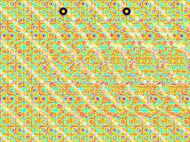 | [**psychedelic-sirds_20260620_193529**](psychedelic-sirds_20260620_193529.html) · [js](psychedelic-sirds_20260620_193529.js) High-precision target for depth to prevent stair-stepping in the stereogram · PASS 1: The Secret Object (Raymarched Depth Map) · Strange impossible object: Gyroid-infused Torus Knot | WebGL2 / three.js |  | shader_files_2 shader_files_2 |
| 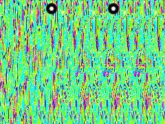 | [**psychedelic-sirds_20260621_191706**](psychedelic-sirds_20260621_191706.html) · [js](psychedelic-sirds_20260621_191706.js) Render target for the depth map · Pass 1: Depth Map Generator (Raymarched SDF) · Polynomial smooth min for organic fusion | WebGL2 / three.js |  | shader_files_2 |
| 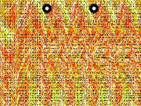 | [**psychedelic-sirds_20260622_211639**](psychedelic-sirds_20260622_211639.html) · [js](psychedelic-sirds_20260622_211639.js) NOISE &amp; MATH UTILS · HIDDEN 3D SDF OBJECT · Center and aspect correct | WebGL2 / three.js |  | shader_files_2 shader_files_2 |
| 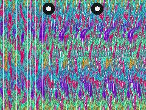 | [**psychedelic-sirds_20260622_220744**](psychedelic-sirds_20260622_220744.html) · [js](psychedelic-sirds_20260622_220744.js) Klein-bottle / Torus knot hybrid · subtract inner core to make it an impossible shell · Add SDF Metaballs | WebGL2 / three.js |  | shader_files_2 shader_files_2 |
| 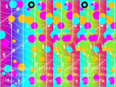 | [**psychedelic-stereogram_20260621_185117**](psychedelic-stereogram_20260621_185117.html) · [js](psychedelic-stereogram_20260621_185117.js) Depth scale (relief intensity) · Seedable pseudo-random generator for deterministic noise · 3D rotation helpers for the floating impossible object | Canvas 2D |  | shader_files_2 |
| 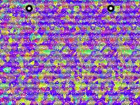 | [**psychedelic-stereogram_20260622_224535**](psychedelic-stereogram_20260622_224535.html) · [js](psychedelic-stereogram_20260622_224535.js) FBO for the depth map · PASS 1: Raymarched Depth Field · Alien Sticker-Object / Torus Knot | WebGL2 / three.js |  | shader_files_2 |
| 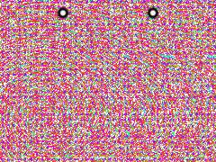 | [**psychedelic_sirds_20260621_185942**](psychedelic_sirds_20260621_185942.html) · [js](psychedelic_sirds_20260621_185942.js)  | WebGL2 / three.js |  | shader_files_2 |
| 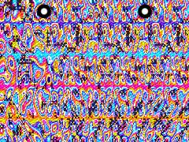 | [**psychedelic_sirds_20260621_211611**](psychedelic_sirds_20260621_211611.html) · [js](psychedelic_sirds_20260621_211611.js) Depth Map Render Target (High Precision) · PASS 1: Depth Map (Raymarched SDF Scene) · Wavy background terrain | WebGL2 / three.js |  | shader_files_2 |
| 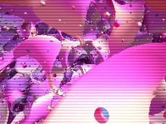 | [**stereo-wiggle_20260622_181341**](stereo-wiggle_20260622_181341.html) · [js](stereo-wiggle_20260622_181341.js) WFC Entropy / Fungal noise field · Triply Periodic Minimal Surfaces (TPMS) · Global spatial warp (Datamoshing / Tensor bias) | WebGL2 / three.js |  | shader_files_2 |
