# 15 · Signal processing & media decay: VHS, CRT, glitch

**What's in here:** VHS tracking/head-switch, CRT phosphor & subpixels, scanlines, datamosh, macroblocks, packet loss.

**The idea in one breath:** Simulates how analog and digital signals break: tape wobble, sync loss, compression blocks. Signal processing run in reverse for beauty.

78 designs. Each is a pair: open the `.html` in any browser (self-contained, no server); the `.js` is the raw sketch source.

| | Design | Renderer | Notes | From |
|---|---|---|---|---|
| 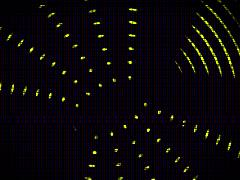 | [**acid-bloom**](acid-bloom.html) · [js](acid-bloom.js) Feral hash for tracking noise · 1. THE DAMAGE: TRACKING GLITCH &amp; TEARING · Group UVs into horizontal bands for VHS-style head-switching/tracking tears | WebGL2 / three.js |  | repo_script_js5_code |
| 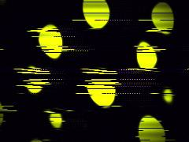 | [**acid-matrix-glitch**](acid-matrix-glitch.html) · [js](acid-matrix-glitch.js) Sinusoidal grating for soft interference (Moire Repo: Technique 04) · V-Sync Slip (Damage Repo: Tearing / Sync Instability) · Tracking Glitch &amp; Head Switching (Damage Repo: VHS Damage) | WebGL2 / three.js |  | repo_script_js5_code |
| 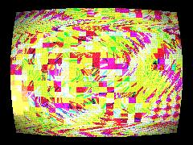 | [**acidic-analog-glitch**](acidic-analog-glitch.html) · [js](acidic-analog-glitch.js) DAMAGE CONTROL CONSTANTS (TWEAK THESE) · UTILITY / NOISE FUNCTIONS · LAYER 1: VHS TAPE MECHANICS &amp; TRACKING TEAR | WebGL2 / three.js |  | repo_script_js5_code |
| 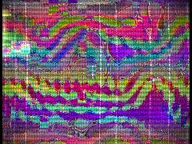 | [**acidic-vhs-decay**](acidic-vhs-decay.html) · [js](acidic-vhs-decay.js) DIGITAL BLOCK DAMAGE · Simulate datamosh / macroblock sticking · Temporal freeze simulation (borrows UVs from nearby blocks) | WebGL2 / three.js |  | repo_script_js5_code |
| 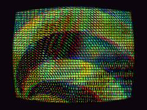 | [**acidic-vhs-rot**](acidic-vhs-rot.html) · [js](acidic-vhs-rot.js) OP-ART SIGNAL DECAY · TWEAKABLE CONSTANTS · Digital / Block | WebGL2 / three.js |  | repo_script_js5_code |
| 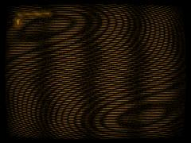 | [**amber-phosphor**](amber-phosphor.html) · [js](amber-phosphor.js) Vertical roll artifact every 10s · Wavy scanline distortion · Two offset scanline grids producing horizontal moiré drift | WebGL2 / three.js |  | repo_script_js5_code |
| 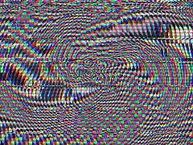 | [**analog-decay**](analog-decay.html) · [js](analog-decay.js) DIGITAL BLOCK CORRUPTION · Datamosh smear: hold previous UV or displace · Occasional full-row displacement | WebGL2 / three.js |  | repo_script_js5_code |
| 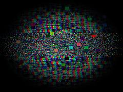 | [**analog_decay**](analog_decay.html) · [js](analog_decay.js) TWEAKABLE DAMAGE CONTROLS · UTILITIES &amp; NOISE · 6. MOIRÉ / OP-ART INTERFERENCE LAYER | WebGL2 / three.js |  | repo_script_js5_code |
| 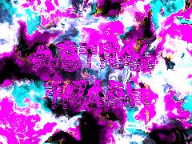 | [**astral-trash**](astral-trash.html) · [js](astral-trash.js)  | WebGL2 / three.js |  | repo_script_js5_code |
| 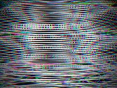 | [**astral-vhs**](astral-vhs.html) · [js](astral-vhs.js) Core background - crushed blacks of an old tape · Non-linear wrapping tracking tear · The Strange Mechanism: The geometry itself is routed through a failing analog head. | Canvas 2D |  | repo_script_js5_code |
| 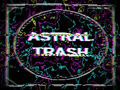 | [**astral_trash**](astral_trash.html) · [js](astral_trash.js) Void black background · Decorative Sacred Geometry / Cyber-Brutalist Frame · Diagonal corner cuts | WebGL2 / three.js |  | repo_script_js5_code |
| 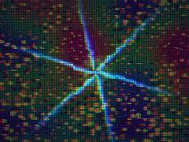 | [**cheaper_20260620_204616**](cheaper_20260620_204616.html) · [js](cheaper_20260620_204616.js) Noise &amp; Math Utilities · Perceptual Color Palette · Core Procedural Scene Generator | WebGL2 / three.js |  | shader_files_2 |
| 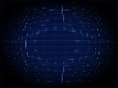 | [**cobalt-scanline**](cobalt-scanline.html) · [js](cobalt-scanline.js) Pristine CRT curve · Square lattice moiré · Crisp, sub-pixel smooth lines | WebGL2 / three.js |  | repo_script_js5_code |
| 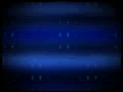 | [**cobalt_scan**](cobalt_scan.html) · [js](cobalt_scan.js) Disabled to preserve pristine pixel-level interference · 1. Pristine Cold Geometry (Subtle CRT Barrel Distortion) · Screen bounds mask | WebGL2 / three.js |  | repo_script_js5_code |
| 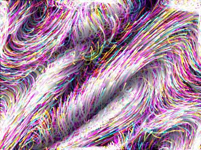 | [**deco-bg**](deco-bg.html) · [js](deco-bg.js)  | Canvas 2D |  | repo_script_js5_code |
| 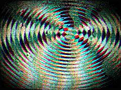 | [**degraded-signal**](degraded-signal.html) · [js](degraded-signal.js) THE HAUNTED SIGNAL: A Feral Moiré / Damage Aesthetic Texture System · EXPLANATION OF LAYERS: · 1. crtCurve: Warps the UV space to simulate the physical bulge of a CRT tube. | WebGL2 / three.js |  | repo_script_js5_code |
| 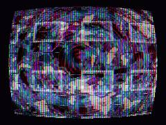 | [**geocities_cathedral_20260709_213125**](geocities_cathedral_20260709_213125.html) · [js](geocities_cathedral_20260709_213125.js) ALCHEMICAL MATH &amp; NOISE ENGINES · [Interaction] Mouse as Magnetic Lens · [Poincaré Hyperbolic Parasite Warp] | WebGL2 / three.js |  | shaderfiles3 |
| 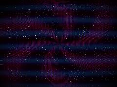 | [**geocities_cathedral_20260713_125256**](geocities_cathedral_20260713_125256.html) · [js](geocities_cathedral_20260713_125256.js) We need FloatType for exact continuous logic (Lenia) and integer accumulation (Sandpile) · Sandpile grains · PASS 1: LIVING MATH ENGINE (Lenia + Sandpile + Reaction Diffusion) | WebGL2 / three.js |  | shaderfiles3 |
| 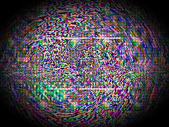 | [**glitchiness1_20260611_151242**](glitchiness1_20260611_151242.html) · [js](glitchiness1_20260611_151242.js) 1. Datamosh / Block corruption (Glitch Cookbook) · 2. Space transform for Op Art (Retinal Surrealism) · 3. Gematria Resonance Fields (Values: 26, 86, 373) | WebGL2 / three.js |  | shader_files_2 |
| 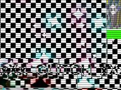 | [**glitchiness3_20260611_151801**](glitchiness3_20260611_151801.html) · [js](glitchiness3_20260611_151801.js) 1. Feedback Loop (Temporal Echo &amp; Datamosh) · Darken slightly to prevent blown out white accumulation · 2. Moiré Interference Pattern (Optical Illusion Core) | Canvas 2D |  | shader_files_2 |
| 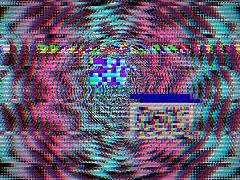 | [**glitchscape**](glitchscape.html) · [js](glitchscape.js) Math &amp; Noise (Gematria &amp; Glitchcore Foundation) · SDFs (Myspace Bling &amp; Early Internet UI) · Color Palettes (Acid Vibration &amp; Hyperpop) | WebGL2 / three.js |  | repo_script_js5_code shader_files_2 shader_files_2 |
| 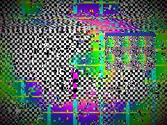 | [**glitchscape_20260611_141952**](glitchscape_20260611_141952.html) · [js](glitchscape_20260611_141952.js) Noise &amp; Hash Functions · Early Internet Window Cascade Logic · Body repeats (tiled background logic) | WebGL2 / three.js |  | repo_script_js5_code shader_files_2 shader_files_2 shader_files_2 |
| 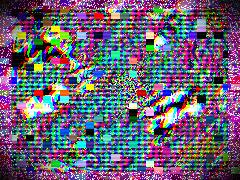 | [**glitchscape_20260611_145149**](glitchscape_20260611_145149.html) · [js](glitchscape_20260611_145149.js) Halftone Screen (Psychedelic Collage / Riso) · Gematria Resonance Warp (Logos 373 / Ichthys 1224) · Op Art Checker Funnel | WebGL2 / three.js |  | shader_files_2 shader_files_2 |
| 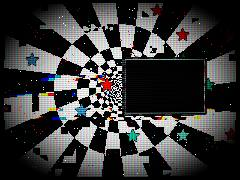 | [**glitchscape_20260611_152823**](glitchscape_20260611_152823.html) · [js](glitchscape_20260611_152823.js)  | WebGL2 / three.js |  | shader_files_2 |
| 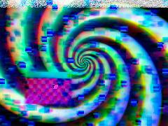 | [**glitchscape_20260611_152952**](glitchscape_20260611_152952.html) · [js](glitchscape_20260611_152952.js) DATABENDING &amp; COMPRESSION MACROBLOCKING · VHS TRACKING TEAR · CLASSIC B&amp;W RETINAL OP-ART TUNNEL | WebGL2 / three.js |  | shader_files_2 shader_files_2 shader_files_2 |
| 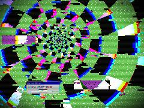 | [**glitchspace**](glitchspace.html) · [js](glitchspace.js) Preserve crusty pixelation · Hash and Noise · Op Art Zeno Tunnel Pattern | WebGL2 / three.js |  | repo_script_js5_code |
| 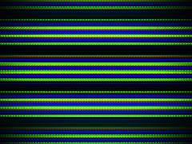 | [**haunted_crt**](haunted_crt.html) · [js](haunted_crt.js) 2D Value Noise for organic static · Perfect looping noise by sampling a 2D circle in noise space · VHS Tracking Tear: horizontal displacement bands drifting upward | WebGL2 / three.js |  | repo_script_js5_code |
| 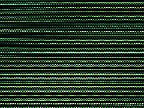 | [**haunted_monitor**](haunted_monitor.html) · [js](haunted_monitor.js)  | WebGL2 / three.js |  | repo_script_js5_code |
| 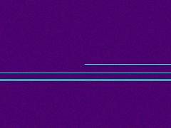 | [**hypercolor_damage_carnival_engine_20260619_111904**](hypercolor_damage_carnival_engine_20260619_111904.html) · [js](hypercolor_damage_carnival_engine_20260619_111904.js) MATH &amp; NOISE (Fractals, Caustics, Datamosh) · EARLY INTERNET UI SHARDS · STRUCTURAL COLOR (Thin Film / Iridescence) | WebGL2 / three.js |  | shader_files_2 shader_files_2 |
| 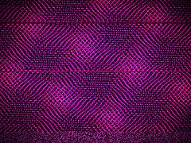 | [**magenta-glitch-tape**](magenta-glitch-tape.html) · [js](magenta-glitch-tape.js) Crossing lines for a woven textile / screen door effect · Tracking Glitch (Tearing &amp; Bands) from the Damage Taxonomy · Head-switching noise at bottom of the frame | WebGL2 / three.js |  | repo_script_js5_code |
| 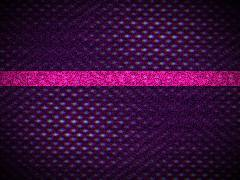 | [**magenta-tape-glitch**](magenta-tape-glitch.html) · [js](magenta-tape-glitch.js) Hash for noise · Continuous sinusoidal grid for soft interference · Woven moire pattern from two diagonal grids | WebGL2 / three.js |  | repo_script_js5_code |
| 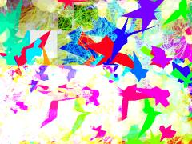 | [**maximalist_weird**](maximalist_weird.html) · [js](maximalist_weird.js) Generate Indra&#x27;s Net nodes · 1. TEMPORAL RECURSION (Smear &amp; Fade) · 2. VEDIC OS / GLITCHCORE TYPOGRAPHY | Canvas 2D |  | repo_script_js5_code |
| 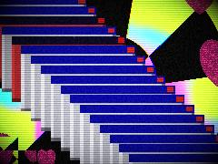 | [**myspace-glitch**](myspace-glitch.html) · [js](myspace-glitch.js) Op-Art Zeno Tunnel · Infinite descent subdivision · MySpace Motifs | WebGL2 / three.js |  | repo_script_js5_code repo_script_js5_code shader_files_2 |
| 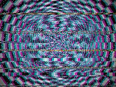 | [**myspace-glitch_20260611_153108**](myspace-glitch_20260611_153108.html) · [js](myspace-glitch_20260611_153108.js) Alchemical Math: Hash &amp; Noise · OKLab to sRGB (Perceptual Color System) · Early Internet &quot;Text Debris&quot; abstraction | WebGL2 / three.js |  | shader_files_2 |
| 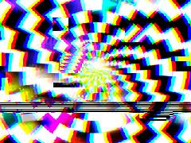 | [**myspace-glitchscape_20260611_153739**](myspace-glitchscape_20260611_153739.html) · [js](myspace-glitchscape_20260611_153739.js) 1. OP-ART LAYER (Retinal Surrealism / Checker Funnel) · Slow radial hypnosis spin · Continuous perspective warp for infinite tunnel illusion | Canvas 2D |  | shader_files_2 |
| 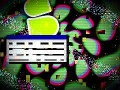 | [**myspace-glitchscape_20260612_004503**](myspace-glitchscape_20260612_004503.html) · [js](myspace-glitchscape_20260612_004503.js) 1. MACROBLOCK COMPRESSION CHEW · 2. HORIZONTAL TEARING · 3. OP-ART TUNNEL (RGB SPLIT) | WebGL2 / three.js |  | shader_files_2 shader_files_2 shader_files_2 |
| 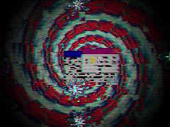 | [**myspace-glitchscape_20260612_005400**](myspace-glitchscape_20260612_005400.html) · [js](myspace-glitchscape_20260612_005400.js) Macroblocking / Candy Crash Compression · Scanline tear / Horizontal tracking error · 1. Moiré / Checkerboard Background (Optical Illusion) | WebGL2 / three.js |  | shader_files_2 |
| 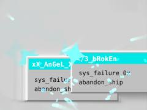 | [**myspace-glitchscape_20260612_005651**](myspace-glitchscape_20260612_005651.html) · [js](myspace-glitchscape_20260612_005651.js) KIYOSHI-ABSORBER-V1: HYPERBOLIC MYSPACE GLITCHSCAPE · A synthesis of early-internet UI debris, reaction-diffusion fungal bloom, · kairotempic infinite zoom (feedback chaos), and macroblock corruption. | Canvas 2D |  | shader_files_2 |
| 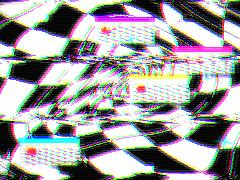 | [**myspace_glitch**](myspace_glitch.html) · [js](myspace_glitch.js) Feral GLSL Shader: Op-Art meets MySpace Glitchcore · Noise &amp; Hash Functions · Retinal Surrealism: Op-Art Space Warp | WebGL2 / three.js |  | repo_script_js5_code shader_files_2 |
| 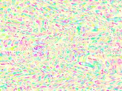 | [**neon-glitch-decay**](neon-glitch-decay.html) · [js](neon-glitch-decay.js) Electric Yellow · Saturated Purple · VHS Magnetic Warping | WebGL2 / three.js |  | repo_script_js5_code repo_script_js5_code |
| 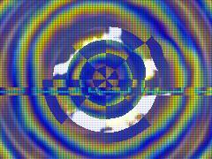 | [**neon-trash-oracle_20260709_112945**](neon-trash-oracle_20260709_112945.html) · [js](neon-trash-oracle_20260709_112945.js) REPO 11 &amp; 15: Color Systems &amp; Spectral Color · &quot;Hyperpop Rupture&quot; palette via cosine interpolation · High energy magenta/cyan/yellow bias | WebGL2 / three.js |  | shaderfiles3 |
| 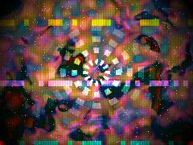 | [**neon-trash-oracle_20260709_114201**](neon-trash-oracle_20260709_114201.html) · [js](neon-trash-oracle_20260709_114201.js) MATH &amp; NOISE (Lenia / Cuttlefish) · COLOR SYSTEMS (OKLab Hyperpop) · PATTERNS &amp; MOIRÉ | WebGL2 / three.js |  | shaderfiles3 shaderfiles3 |
| 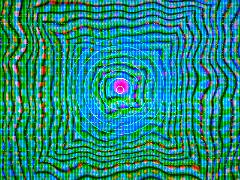 | [**neon-trash-oracle_20260725_235816**](neon-trash-oracle_20260725_235816.html) · [js](neon-trash-oracle_20260725_235816.js) [damage_aesthetics / voronoi_systems] Hash &amp; Noise functions · [color_systems] OKLab perceptual color interpolation · Hyper-saturated candy-acid palette generator | WebGL2 / three.js |  | shaderfiles3 shaderfiles3 |
| 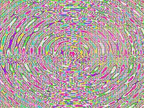 | [**neon_glitch_decay**](neon_glitch_decay.html) · [js](neon_glitch_decay.js) CORE NOISE FUNCTIONS · STRICT COLOR PALETTE MAPPING · Forces all color math into the allowed high-saturation glitchcore palette | WebGL2 / three.js |  | repo_script_js5_code repo_script_js5_code |
| 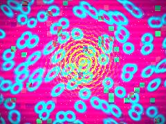 | [**neon_trash_oracle_20260709_132828**](neon_trash_oracle_20260709_132828.html) · [js](neon_trash_oracle_20260709_132828.js) NEON TRASH ORACLE WEATHER SYSTEM · A feral synthesis of 16 repos: Lenia, Cuttlefish Chromatics, Plateau Foam, · I Ching Fields, Abelian Sandpile, Moiré, Op Art, Glitchcore, Damage Aesthetics, | WebGL2 / three.js |  | shaderfiles3 |
| 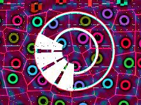 | [**neon_trash_oracle_20260709_133206**](neon_trash_oracle_20260709_133206.html) · [js](neon_trash_oracle_20260709_133206.js) glslVersion: THREE.GLSL3 applies implicitly via ShaderMaterial · [color_systems] + [glitchcore_style] Hyperpop Acid Palette · Offsets for Hot Pink, Electric Cyan, Neon Yellow, Ultraviolet | WebGL2 / three.js |  | shaderfiles3 shaderfiles3 |
| 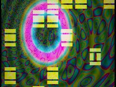 | [**neon_trash_oracle_20260709_133509**](neon_trash_oracle_20260709_133509.html) · [js](neon_trash_oracle_20260709_133509.js) OKLab-inspired candy-acid palette (color_systems, glitchcore_style) · Push saturation to hyperpop neon · Hyperbolic warp (lovecraft_os, dream_physics) | WebGL2 / three.js |  | shaderfiles3 |
| 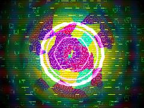 | [**neon_trash_oracle_20260725_233040**](neon_trash_oracle_20260725_233040.html) · [js](neon_trash_oracle_20260725_233040.js) Bypass projection/modelview to draw a full-screen quad directly in clip space · NEON TRASH ORACLE WEATHER SYSTEM · temporal_desync &amp; saccadic_masking: Saccadic glitches and temporal time shifts | WebGL2 / three.js |  | shaderfiles3 shaderfiles3 |
| 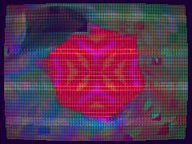 | [**phosphor_reef_engine_20260620_151508**](phosphor_reef_engine_20260620_151508.html) · [js](phosphor_reef_engine_20260620_151508.js) Cleanup previous instances if they exist · Ping-pong FBO setup for Datamosh / Temporal Echo · SHADER 1: THE PHOSPHOR REEF ENGINE (Feedback, Geometry, Datamosh, Cuttlefish) | WebGL2 / three.js |  | shader_files_2 |
| 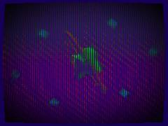 | [**phosphor_reef_engine_20260620_180411**](phosphor_reef_engine_20260620_180411.html) · [js](phosphor_reef_engine_20260620_180411.js) Core Reactor (Crystalline / Demoscene) · Orbiting Rings · Cuttlefish rippling | WebGL2 / three.js |  | shader_files_2 shader_files_2 shader_files_2 |
|  | [**phosphor_reef_engine_20260620_181827**](phosphor_reef_engine_20260620_181827.html) · [js](phosphor_reef_engine_20260620_181827.js) Ping-pong targets for temporal memory, datamoshing, and cuttlefish simulation · BUFFER A: THE LIVING PHOSPHOR REEF / DATAMOSH / HYPERBOLIC ENGINE · Hash functions | WebGL2 / three.js |  | shader_files_2 shader_files_2 shader_files_2 |
|  | [**phosphor_reef_engine_20260620_183416**](phosphor_reef_engine_20260620_183416.html) · [js](phosphor_reef_engine_20260620_183416.js) Hashing &amp; Noise (Glitchcore / Datamosh / Procedural Gen) · Hyperbolic Tiling Fold (Poincare approx via inversion) · Crystalline SDF (Octahedron/Diamond Reactor) | WebGL2 / three.js |  | shader_files_2 shader_files_2 shader_files_2 |
|  | [**phosphor_reef_engine_20260620_184844**](phosphor_reef_engine_20260620_184844.html) · [js](phosphor_reef_engine_20260620_184844.js) PASS A: The Phosphor Reef Engine (Base Geometry, Datamosh, Feedback) · Hyperbolic / Mobius Inversion · 1. Autostereogram Wallpaper Shift | WebGL2 / three.js |  | shader_files_2 shader_files_2 shader_files_2 |
|  | [**phosphor_reef_engine_20260620_203835**](phosphor_reef_engine_20260620_203835.html) · [js](phosphor_reef_engine_20260620_203835.js) Render Targets for Ping-Pong Feedback (Datamosh / Cuttlefish memory) · Nearest for datamosh/glitch feel · Float for accumulation/feedback | WebGL2 / three.js |  | shader_files_2 shader_files_2 |
|  | [**phosphor_reef_engine_20260620_210004**](phosphor_reef_engine_20260620_210004.html) · [js](phosphor_reef_engine_20260620_210004.js) PHOSPHOR SIGNAL REEF ENGINE — Fused Alchemical Masterpiece by The Weird Code Guy · Fusing: cuttlefish_chromatics (live display stack) + vhs_analog_artifacts (signal decay) · + color_systems (perceptual OKLab spaces) + glitchcore_style (hyperpop rupture energy) | WebGL2 / three.js |  | shader_files_2 |
|  | [**phosphor_reef_engine_20260620_210938**](phosphor_reef_engine_20260620_210938.html) · [js](phosphor_reef_engine_20260620_210938.js) Screen-aligned orthographic setup · OKLAB COLOR CONVERSIONS · RAYMARCHED SIGNAL REEF SDF | WebGL2 / three.js |  | shader_files_2 |
|  | [**phosphor_reef_engine_20260620_212759**](phosphor_reef_engine_20260620_212759.html) · [js](phosphor_reef_engine_20260620_212759.js) Perceptual noise functions · Core generator combining multiple repo DNA styles · 1. Datamosh coordinate distortion (macroblocks + flow field) | WebGL2 / three.js |  | shader_files_2 shader_files_2 |
|  | [**phosphor_reef_engine_20260620_213714**](phosphor_reef_engine_20260620_213714.html) · [js](phosphor_reef_engine_20260620_213714.js) HASH &amp; NOISE UTILITIES · OKLAB COLOR SPACE TRANSFORMS · MAIN GEOMETRY AND SYNTHESIS | WebGL2 / three.js |  | shader_files_2 shader_files_2 |
|  | [**phosphor_reef_engine_20260620_230957**](phosphor_reef_engine_20260620_230957.html) · [js](phosphor_reef_engine_20260620_230957.js) Pseudo-random Hash · 2D Value Noise · Fractal Brownian Motion | WebGL2 / three.js |  | shader_files_2 shader_files_2 |
|  | [**phosphor_reef_engine_20260620_233924**](phosphor_reef_engine_20260620_233924.html) · [js](phosphor_reef_engine_20260620_233924.js) Phosphor Signal Reef Engine · combining oldschool demoscene visual bravado, cuttlefish skin simulation, anamorphic flares, · and datamoshed temporal feedback. | WebGL2 / three.js |  | shader_files_2 shader_files_2 |
|  | [**phosphor_reef_engine_20260620_235032**](phosphor_reef_engine_20260620_235032.html) · [js](phosphor_reef_engine_20260620_235032.js) MATH &amp; NOISE HELPERS · COLOR SYSTEMS (OKLab / OKLCh) · BRAGG REFLECTION (IRIDOPHORE GLOW) | WebGL2 / three.js |  | shader_files_2 |
|  | [**phosphor_reef_engine_20260621_125033**](phosphor_reef_engine_20260621_125033.html) · [js](phosphor_reef_engine_20260621_125033.js) OKLab / OKLCh conversions · Noise / FBM generators · Barrel distortion | WebGL2 / three.js |  | shader_files_2 |
|  | [**phosphor_reef_engine_20260621_125544**](phosphor_reef_engine_20260621_125544.html) · [js](phosphor_reef_engine_20260621_125544.js) Mathematical Utilities · Halftone Pattern Generator · Cuttlefish Chromatophore Grid | WebGL2 / three.js |  | shader_files_2 shader_files_2 |
|  | [**phosphor_reef_engine_20260621_130242**](phosphor_reef_engine_20260621_130242.html) · [js](phosphor_reef_engine_20260621_130242.js) Chromatophores (Cuttlefish grid) · Popups / Early Internet Aesthetic Elements · Integrate Halftone logic | WebGL2 / three.js |  | shader_files_2 |
|  | [**phosphor_reef_engine_20260621_173257**](phosphor_reef_engine_20260621_173257.html) · [js](phosphor_reef_engine_20260621_173257.js) 1. Mathematical Primities &amp; Noise · 2. Perceptual OKLab Colorspace Conversions · 3. Halftone Mosaic Overlay | WebGL2 / three.js |  | shader_files_2 shader_files_2 |
|  | [**phosphor_reef_engine_20260621_183223**](phosphor_reef_engine_20260621_183223.html) · [js](phosphor_reef_engine_20260621_183223.js) Animated background plasma lines · Draw rotating oldskool demoscene polygons · Draw chromatophores (expanding pigment spots) | WebGL2 / three.js |  | shader_files_2 |
|  | [**red_cctv**](red_cctv.html) · [js](red_cctv.js) Tape Tracking Tear (Random horizontal shifts) · Head switching noise · 1. Moiré Crimson Grid | WebGL2 / three.js |  | repo_script_js5_code |
|  | [**rgb_subpixels**](rgb_subpixels.html) · [js](rgb_subpixels.js) Calculate grid scaling based on resolution to maintain square cells · Subpixel triad centers within the cell · Aspect correction for the subpixels so they render as circular dots | WebGL2 / three.js |  | repo_script_js5_code |
|  | [**rotting_signal**](rotting_signal.html) · [js](rotting_signal.js) CONTROLS &amp; CONSTANTS · CORE UTILITIES · LAYER 1: OP-ART &amp; MOIRÉ INTERFERENCE | WebGL2 / three.js |  | repo_script_js5_code repo_script_js5_code |
|  | [**screendoor**](screendoor.html) · [js](screendoor.js) Barrel distortion (face pressed against monitor lens effect) · Wobble (very slight grid instability / micro-saccades) · Pixel scaling - extremely high density but visible | WebGL2 / three.js |  | repo_script_js5_code |
|  | [**signal_decay**](signal_decay.html) · [js](signal_decay.js) FERAL MATH &amp; NOISE PRIMITIVES · 1. DIGITAL GLITCH &amp; COMPRESSION ROT · Simulates macroblock failure, datamoshing, and packet loss | WebGL2 / three.js |  | repo_script_js5_code |
|  | [**subpixel-grid**](subpixel-grid.html) · [js](subpixel-grid.js) Domain warp for subtle magnetic/thermal wobble · 1. VR Lens Distortion (Barrel) · Distort coordinates outward | WebGL2 / three.js |  | repo_script_js5_code |
|  | [**subpixel_grid**](subpixel_grid.html) · [js](subpixel_grid.js) Grid density - determines the scale of the subpixel triads · Horizontal offsets for R, G, B subpixels within the cell · Vertical centering with slight elongation | WebGL2 / three.js |  | repo_script_js5_code |
|  | [**vhs-pause**](vhs-pause.html) · [js](vhs-pause.js) Hash and Noise · Distance field for a box · Abstract pattern (looks like paused video UI or fragmented content) | WebGL2 / three.js |  | repo_script_js5_code |
|  | [**vhs_crt_glitch**](vhs_crt_glitch.html) · [js](vhs_crt_glitch.js) Impossible Space / Reaction Diffusion Simulation via Domain Warp · Moiré Mid-Layer (Sinusoidal Liquid Interference) · Two slightly offset grids to create spatial beat frequencies | WebGL2 / three.js |  | repo_script_js5_code |
|  | [**vhs_glitch**](vhs_glitch.html) · [js](vhs_glitch.js) V-Sync Logic: The analog roll · Sync loss burst · Function to draw the SMPTE color bars and base analog signal | Canvas 2D |  | repo_script_js5_code |
|  | [**vhs_pause**](vhs_pause.html) · [js](vhs_pause.js) Feral Hash for tape noise · Wave Sinusoidal Moiré (Repo: moire-as-point/04_wave_sinusoidal) · Creates smooth, liquid fringes rather than sharp digital bands. | WebGL2 / three.js |  | repo_script_js5_code |
|  | [**vivid_glitch_decay**](vivid_glitch_decay.html) · [js](vivid_glitch_decay.js) Pseudo-random hash functions · The core Op-Art / Moiré signal generator · Radial Hypnosis Field | WebGL2 / three.js |  | repo_script_js5_code repo_script_js5_code |
