# 16 · Dithering, halftone & print

**What's in here:** Bayer / ordered dithering, halftone dots, Risograph & CMY(K) misregistration, palette quantization.

**The idea in one breath:** Faking many colors with few: arrange dots of limited inks in clever grids (dither, halftone) so your eye blends them.

11 designs. Each is a pair: open the `.html` in any browser (self-contained, no server); the `.js` is the raw sketch source.

| | Design | Renderer | Notes | From |
|---|---|---|---|---|
| 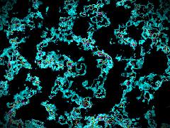 | [**cmy-grain**](cmy-grain.html) · [js](cmy-grain.js) Mathematical Foundation: 3D Hash &amp; Noise · Medium Scale: Fractal Brownian Motion · The Topology: Mycelial Gyroid Math | WebGL2 / three.js |  | repo_script_js5_code |
| 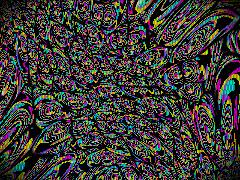 | [**cmy-substance_20260709_104234**](cmy-substance_20260709_104234.html) · [js](cmy-substance_20260709_104234.js) Hash function for deterministic chaos · Metric Competition: Morphing distance manifold (L0.5 to L2.5) · Guard against pow(0) | WebGL2 / three.js |  | shaderfiles3 shaderfiles3 |
| 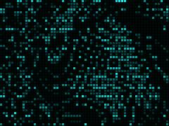 | [**cyan_matrix**](cyan_matrix.html) · [js](cyan_matrix.js) Hyperbolic manifold projection · XOR-Ghost Manifold: addressable trauma in the matrix · Fluid turbulence | Canvas 2D |  | repo_script_js5_code |
| 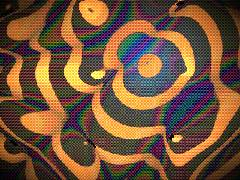 | [**dynamic-art**](dynamic-art.html) · [js](dynamic-art.js) Bayer 4x4 Dither Matrix (pixel_voxel repo) · Wavelength to RGB Conversion (structural_color repo) · Thin-Film Interference calculation | WebGL2 / three.js |  | repo_script_js5_code |
| 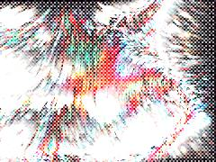 | [**dynamic-design**](dynamic-design.html) · [js](dynamic-design.js) Flat array for data locality &amp; performance: [x, y, vx, vy, life, maxLife, ... ] · [REPO GENOME: pixel_voxel] · Generate an offline Bayer 4x4 dither pattern for the &quot;Ditherpunk&quot; overlay | Canvas 2D |  | repo_script_js5_code |
| 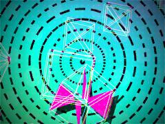 | [**dynamic-git-art**](dynamic-git-art.html) · [js](dynamic-git-art.js) INITIALIZATION · Psychedelic Collage Halftone/Riso Pattern · MATH &amp; PHYSICS | Canvas 2D |  | repo_script_js5_code |
| 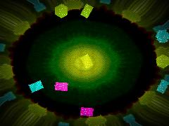 | [**dynamic-interactive**](dynamic-interactive.html) · [js](dynamic-interactive.js) Psychedelic Collage: Displacement Warp (Simplex Noise) · Psychedelic Collage: Kaleidoscope Pattern · Rotational drift | WebGL2 / three.js |  | repo_script_js5_code |
| 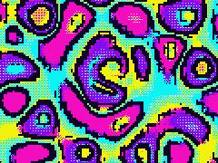 | [**git-art**](git-art.html) · [js](git-art.js) pxv.technique.bayer_4x4.v1 · Lisa Frank x Voxel Palette · pxv.shader.palette_map_nearest.v1 | WebGL2 / three.js |  | repo_script_js5_code |
| 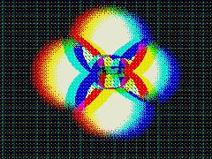 | [**klein-dither**](klein-dither.html) · [js](klein-dither.js) Complex math for Möbius transformations (from kleinian_groups) · 4x4 Bayer Matrix (from dither repo) · IQ Cosine Palette - Neon Acid (from color_fields) | WebGL2 / three.js |  | repo_script_js5_code |
| 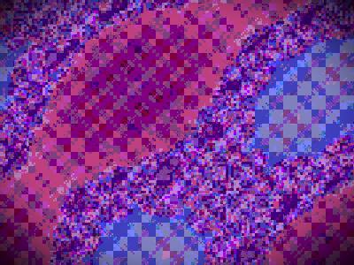 | [**rainblow-ditherscape**](rainblow-ditherscape.html) · [js](rainblow-ditherscape.js) FRACTAL &amp; METRIC COMPETITION LOGIC · DITHER ENGINES · XOR-Ghost Manifold (Bitwise coordinate logic) | WebGL2 / three.js |  | repo_script_js5_code |
| 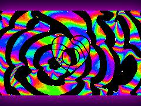 | [**RepoFlow**](RepoFlow.html) · [js](RepoFlow.js) 14-Color &quot;Lisa Frank&quot; Acid Palette · Dark Space Purple · Precompute YUV for accurate perceptual color distance | Canvas 2D |  | repo_script_js5_code |
