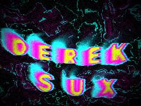
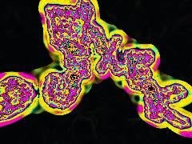
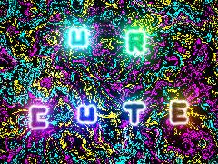
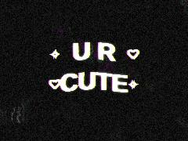

# 17 · Typography, text & glyph systems

**What's in here:** Kinetic type physics, SDF glyphs, text-texture shaders, character-grid art.

**The idea in one breath:** Letters as material: words with gravity, bubble glyphs, text stamped into fields.

5 designs. Each is a pair: open the `.html` in any browser (self-contained, no server); the `.js` is the raw sketch source.

| | Design | Renderer | Notes | From |
|---|---|---|---|---|
|  | [**bold-repo-art**](bold-repo-art.html) · [js](bold-repo-art.js)  | Canvas 2D |  | repo_script_js5_code |
|  | [**derek-sux-material**](derek-sux-material.html) · [js](derek-sux-material.js) 2. Initialize Kinetic Typography Physics · Clear offscreen to black initially · The Three Simultaneous Time Scales | WebGL2 / three.js |  | repo_script_js5_code |
|  | [**derek_sux_texture**](derek_sux_texture.html) · [js](derek_sux_texture.js) Feral Setup: Cache check to prevent re-initialization · KINETIC TYPE STORM: Physics State Initialization · ALCHEMICAL MATH: Hash &amp; Noise | WebGL2 / three.js |  | repo_script_js5_code repo_script_js5_code |
|  | [**neon-cute-texture**](neon-cute-texture.html) · [js](neon-cute-texture.js) Alchemical Math: Hashes &amp; Noise · Typographic Physics: SDF Primitives · Morphogenesis smooth min (Fungal growth / Metaballs) | WebGL2 / three.js |  | repo_script_js5_code |
|  | [**urcute_texture**](urcute_texture.html) · [js](urcute_texture.js) Create the &quot;U R CUTE&quot; text texture · Draw cute ornaments · Hash and Noise functions for organic/physical texture | WebGL2 / three.js |  | repo_script_js5_code |
