# 18 · Biomimicry: reefs, colonies & living systems

**What's in here:** Phosphor reefs, volvox colonies, Haeckel radial forms, phyllotaxis (137.5°), bioluminescence.

**The idea in one breath:** Math borrowed from organisms: golden-angle sunflower spirals, radial radiolarians, glowing coral colonies.

11 designs. Each is a pair: open the `.html` in any browser (self-contained, no server); the `.js` is the raw sketch source.

| | Design | Renderer | Notes | From |
|---|---|---|---|---|
| 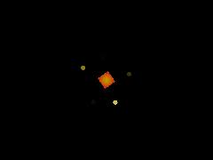 | [**git-bloom_20260614_115547**](git-bloom_20260614_115547.html) · [js](git-bloom_20260614_115547.js) Hash &amp; Noise (merrys_visual_bible) · Domain Warping: The Ocean / Math · Palettes: Neon Acid &amp; Tetragrammaton (color_fields / visual_bible) | WebGL2 / three.js |  | shader_files_2 |
| 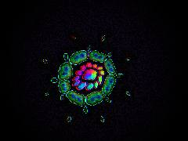 | [**git-bloom_20260614_115928**](git-bloom_20260614_115928.html) · [js](git-bloom_20260614_115928.js)  | WebGL2 / three.js |  | shader_files_2 |
| 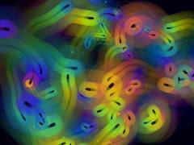 | [**git-flora_20260614_114641**](git-flora_20260614_114641.html) · [js](git-flora_20260614_114641.js) STATE INITIALIZATION (Wet Engine / Morphogenesis Protocol) · 12-fold Haeckel radial symmetry · 1. PHOSPHOR TRAIL / VOID BLOOM BACKGROUND | Canvas 2D |  | shader_files_2 |
| 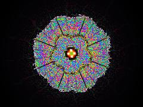 | [**git-garden_20260614_115206**](git-garden_20260614_115206.html) · [js](git-garden_20260614_115206.js) ALCHEMICAL MATH &amp; NOISE · Multi-scale Turing-like FBM · Domain Warping - The Ocean/Math Phenomenon | WebGL2 / three.js |  | shader_files_2 |
| 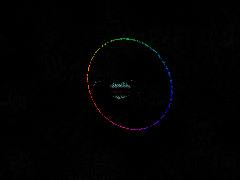 | [**github-garden_20260614_120217**](github-garden_20260614_120217.html) · [js](github-garden_20260614_120217.js) Optimize for performance · THE FERAL SHADER: · A synthesis of Botanical Illustration (Haeckel radial folds, stipple), | WebGL2 / three.js |  | shader_files_2 |
| 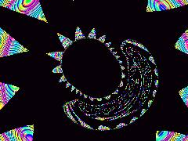 | [**neon-biomorph**](neon-biomorph.html) · [js](neon-biomorph.js) NEON CMY COLOR MAP · MAGNETIC DIPOLE FIELD · B = (3(m.r)r - m) / r^3 | WebGL2 / three.js |  | repo_script_js5_code |
| 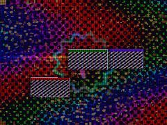 | [**phosphor_signal_reef_engine_20260621_131609**](phosphor_signal_reef_engine_20260621_131609.html) · [js](phosphor_signal_reef_engine_20260621_131609.js)  | WebGL2 / three.js |  | shader_files_2 |
| 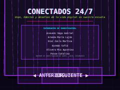 | [**phosphor_signal_reef_engine_20260621_173949**](phosphor_signal_reef_engine_20260621_173949.html) · [js](phosphor_signal_reef_engine_20260621_173949.js) Phosphor Signal Reef Engine — Interactive Editorial Report Viewer · Built by The Weird Code Guy. · State Management | Canvas 2D |  | shader_files_2 |
| 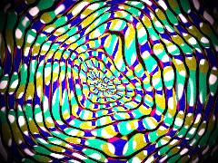 | [**repo-logic-shader**](repo-logic-shader.html) · [js](repo-logic-shader.js) Optimize for performance · 137.508 degrees in radians · [damage_aesthetics] &amp; [shoegaze_style]: Film grain noise | WebGL2 / three.js |  | repo_script_js5_code |
| 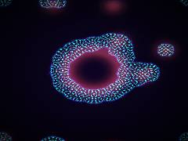 | [**volvox-disco-reactor**](volvox-disco-reactor.html) · [js](volvox-disco-reactor.js) Trace / memory decays slowly · Mouse interaction · Auto-seed to prevent colony death | WebGL2 / three.js |  | repo_script_js5_code |
| 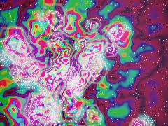 | [**volvox_disco_reactor**](volvox_disco_reactor.html) · [js](volvox_disco_reactor.js) Core Math &amp; Hashes · Sparkles Repo: Temporal Stochastic Sparkle · Golden angle temporal offset for anti-flicker | WebGL2 / three.js |  | repo_script_js5_code |
