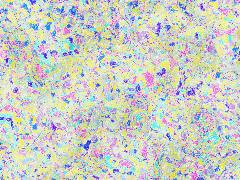
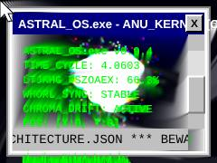
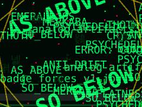
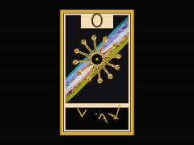
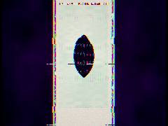
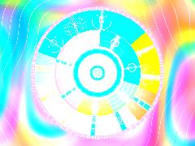
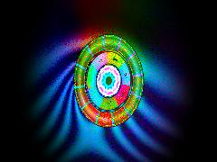
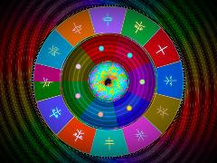
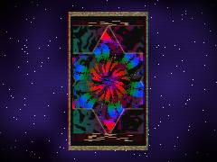
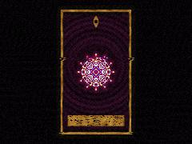

# 19 · Symbolic systems: tarot, I Ching, zodiac

**What's in here:** 64-hexagram I Ching fields, tarot card engines, zodiac sigils, gematria—combinatorics as visual systems.

**The idea in one breath:** Divination decks are finite combinatorial systems (64 hexagrams = 6 bits). These pieces turn those symbol sets into generative structure.

10 designs. Each is a pair: open the `.html` in any browser (self-contained, no server); the `.js` is the raw sketch source.

| | Design | Renderer | Notes | From |
|---|---|---|---|---|
|  | [**acid-iching**](acid-iching.html) · [js](acid-iching.js) THE WEIRD CODE GUY - KIYOSHI-ABSORBER-V1 MODULE · [ALCHEMICAL SCRIPTURE W-10]: XOR-Ghost Manifold applied to Fungal Bureaucracy · DIRECTIVE: Procedural Material. No character grids. | WebGL2 / three.js |  | repo_script_js5_code |
|  | [**anu**](anu.html) · [js](anu.js)  | Canvas 2D |  | repo_script_js5_code |
|  | [**emerald-tablets**](emerald-tablets.html) · [js](emerald-tablets.js) LAYER 1: EMERALD OS (The esoteric terminal void) · Columns shift in opposite directions, bureaucratic failure style · Deterministic chaos seed | Canvas 2D |  | repo_script_js5_code |
|  | [**math-tarot_20260614_113837**](math-tarot_20260614_113837.html) · [js](math-tarot_20260614_113837.js) THE ORACLE OF THE DEEP COMPILE · A feral tarot system combining Gematria resonance frequencies, · Op-Art moiré interference, Botanical radial symmetry, | Canvas 2D |  | shader_files_2 |
|  | [**math-tarot_20260614_114129**](math-tarot_20260614_114129.html) · [js](math-tarot_20260614_114129.js) [FORBIDDEN MATH &amp; NOISE RITUALS] · [SACRED GEOMETRY SDFs] · [LITHOGENESIS &amp; STRUCTURAL COLOR] | WebGL2 / three.js |  | shader_files_2 |
|  | [**qolorful_zodiac_20260627_193308**](qolorful_zodiac_20260627_193308.html) · [js](qolorful_zodiac_20260627_193308.js) Complex math for domain coloring · OKLab to sRGB for perceptually uniform, electric colors · Opal/Prism Iridescence | WebGL2 / three.js |  | shader_files_2 shader_files_2 |
|  | [**qolorful_zodiac_engine_20260627_193715**](qolorful_zodiac_engine_20260627_193715.html) · [js](qolorful_zodiac_engine_20260627_193715.js) Complex Domain Math · OKLCh Color Space (Perceptual Uniformity) · Spectral Iridescence (Opal/Prism) | WebGL2 / three.js |  | shader_files_2 |
|  | [**qolorful_zodiac_engine_20260627_194602**](qolorful_zodiac_engine_20260627_194602.html) · [js](qolorful_zodiac_engine_20260627_194602.js) Color Space: OKLab to sRGB · Base Polar Coordinates · 1. Background Domain Coloring (r &gt; 0.95) | WebGL2 / three.js |  | shader_files_2 |
|  | [**tarot-math_20260612_220726**](tarot-math_20260612_220726.html) · [js](tarot-math_20260612_220726.js)  | WebGL2 / three.js |  | shader_files_2 |
|  | [**tarot-math_20260614_113600**](tarot-math_20260614_113600.html) · [js](tarot-math_20260614_113600.js) Core Feral Math &amp; Noise · Structural Color: Thin Film Interference · Botanical Illustration: Haeckel Radial Symmetry | WebGL2 / three.js |  | shader_files_2 |
